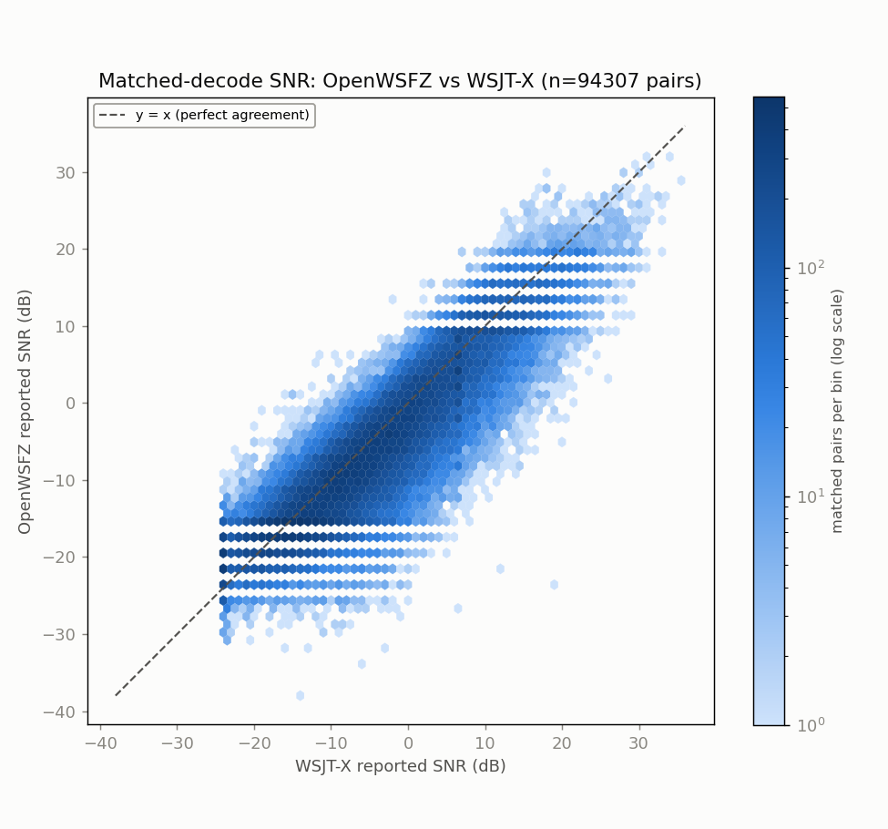
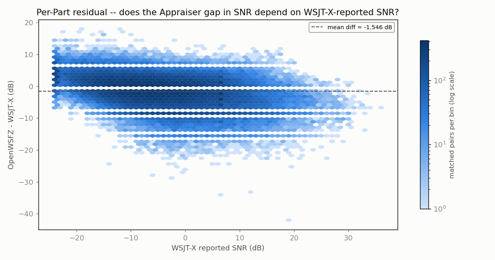
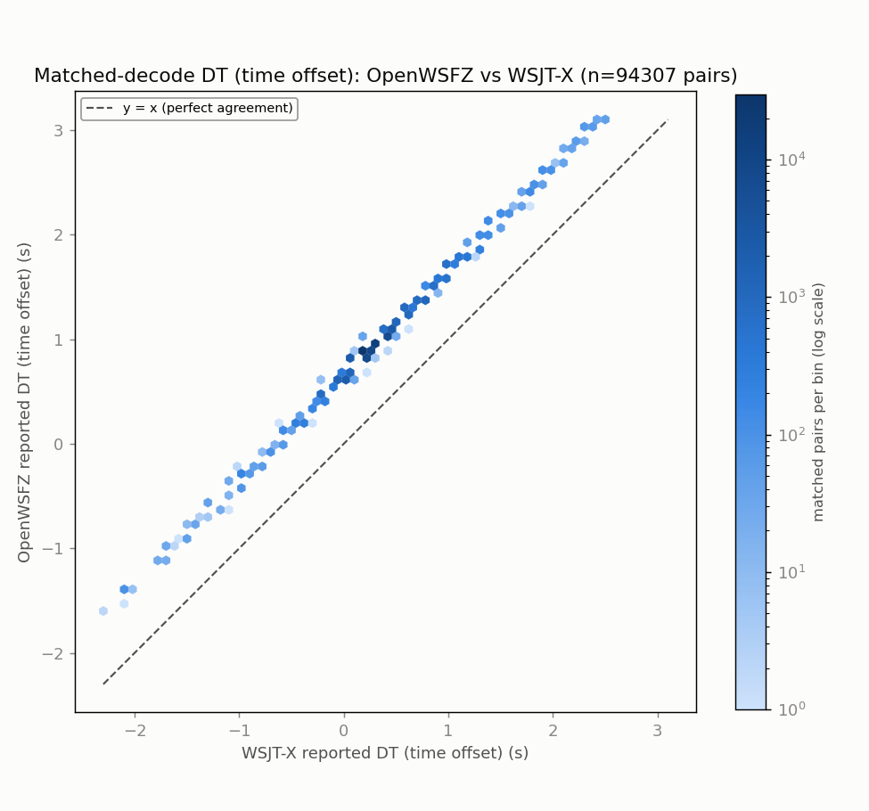
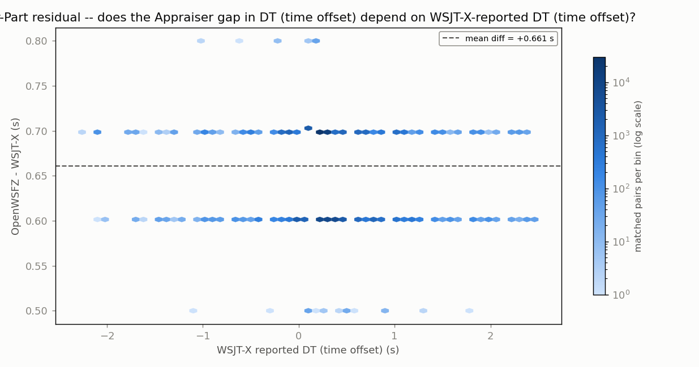
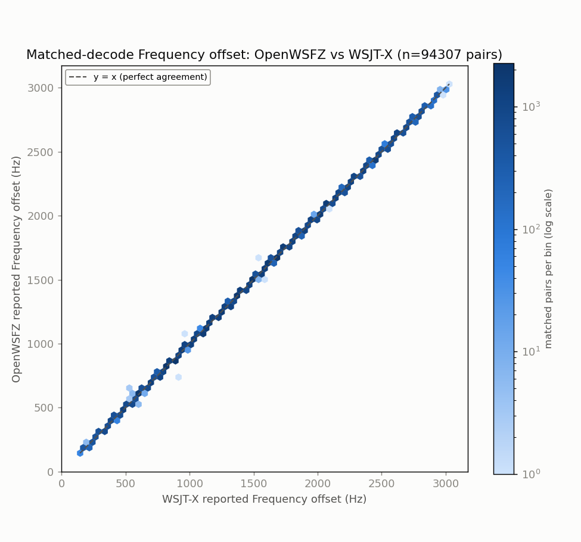
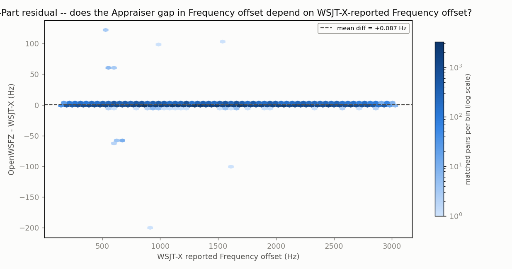

## Grid-alignment gate (per HK-021, 2026-08-02 correction)

| appraiser | unique ts | on-grid | G | row | verdict |
|---|---:|---:|---:|---|---|
| OpenWSFZ | 4296 | 4296 | 1.0000 | ROW 1 | PASS |
| WSJT-X | 4296 | 4296 | 1.0000 | ROW 1 | PASS |

# Endurance-session ANOVA -- matched-decode metrics (OpenWSFZ vs WSJT-X)

**Run:** 2026-09-30 SUB-FEAS flag-ON 40m (OpenWSFZ vs live WSJT-X)  
**Generated:** 2026-10-01T14:29:31Z (`date -u`, HK-017)  
**Design:** two-way ANOVA without replication (randomized complete block design) -- Part (matched decode instance) x Appraiser (OpenWSFZ, WSJT-X), run separately for each paired numeric response below (SNR, DT, frequency offset) over the identical matched Parts. See anova_common.py's module docstring for why this design applies to single-pass live data, and not the replicated design in `qa/rr-study/harness/anova_compute.py`.

Both appraisers' decode logs come from the same live session already on disk -- OpenWSFZ's own ALL.TXT and the real WSJT-X application's own ALL.TXT, both listening to the same physical radio feed throughout. No re-decoding was performed (contrast endurance_anova_jt9.py, used when there is no live third-party log to read).

- OpenWSFZ decodes in window: **95383**
- WSJT-X decodes in window: **129608**
- Matched pairs (Parts, shared across every response below): **94307**

## Decode coverage

- OpenWSFZ decoded **95383** messages in this window; WSJT-X decoded **129608**.
- **94307** decodes matched between the two (same cycle + normalised message text) -- **98.9%** of OpenWSFZ's decodes, **72.8%** of WSJT-X's decodes.
- OpenWSFZ-only (WSJT-X did not report it): **1076** (1.1% of OpenWSFZ's total).
- WSJT-X-only (OpenWSFZ did not report it): **35301** (27.2% of WSJT-X's total).

## SNR (dB)

| Source | SS | df | MS | F | P |
|---|---:|---:|---:|---:|---:|
| Part | 15815142.7069 | 94306 | 167.7003 | 15.783 | 0.0000 |
| Appraiser | 112723.0181 | 1 | 112723.0181 | 10608.879 | 0.0000 |
| Residual (confounded with interaction, n=1/cell) | 1002033.9819 | 94306 | 10.6253 | | |
| Total | 16929899.7069 | 188613 | | | |

Appraiser means (SNR, dB): OpenWSFZ -5.943 dB, WSJT-X -4.396 dB, grand mean -5.170 dB.

## DT (time offset) (s)

| Source | SS | df | MS | F | P |
|---|---:|---:|---:|---:|---:|
| Part | 22429.1693 | 94306 | 0.2378 | 197.544 | 0.0000 |
| Appraiser | 20606.4349 | 1 | 20606.4349 | 17115635.275 | 0.0000 |
| Residual (confounded with interaction, n=1/cell) | 113.5401 | 94306 | 0.0012 | | |
| Total | 43149.1443 | 188613 | | | |

Appraiser means (DT (time offset), s): OpenWSFZ 0.9583 s, WSJT-X 0.2972 s, grand mean 0.6278 s.

## Frequency offset (Hz)

| Source | SS | df | MS | F | P |
|---|---:|---:|---:|---:|---:|
| Part | 89551333073.4049 | 94306 | 949582.5618 | 590770.866 | 0.0000 |
| Appraiser | 353.6317 | 1 | 353.6317 | 220.008 | 0.0000 |
| Residual (confounded with interaction, n=1/cell) | 151583.8683 | 94306 | 1.6074 | | |
| Total | 89551485010.9049 | 188613 | | | |

Appraiser means (Frequency offset, Hz): OpenWSFZ 1482.4 Hz, WSJT-X 1482.3 Hz, grand mean 1482.4 Hz.

## Caveat (structural, not a defect)

With one observation per Part x Appraiser cell -- a live signal happens once -- the interaction term and the residual/error term are mathematically confounded (standard property of an unreplicated factorial design), for every response above. Each table can say whether the two appraisers' *mean* value differs after removing part-to-part variation (the Appraiser row); none of them can separately test whether that difference itself varies signal-to-signal.

Cross-run comparison and interpretation of these numbers is Architect/Captain territory, not this module's.

## Section 4 -- Historical trend: every standardised endurance run to date

4 run(s). `G` is the grid-alignment gate (the lower of the two appraisers' where both are known; ROW 1 PASS >= 0.99). `Ref.` is the second appraiser: live WSJT-X on the same feed, an offline `jt9 -d 3` re-decode, or n/a for a comparison that wasn't against a reference decoder at all (e.g. OpenWSFZ vs OpenWSFZ) -- **offline and n/a rows are marked non-comparable** (HK-031: `jt9 -d 3` offline is not a valid reference decoder) and must not be pooled or compared against live-WSJT-X rows. **Never pool `nhard` 60 and `nhard` 40 runs together.** `Matched %` and `OWS-only %` are each source report's own stated decode-coverage figures (matched as a share of the reference's own decodes; OpenWSFZ-only as a share of OpenWSFZ's own decodes), not recomputed here. `DT gap` has no `+/- SD` column: none of the pre-standardisation reports computed a standalone SD of the DT offset (only appraiser means), and deriving one now from raw logs would be new analysis, not backfill -- it is left out rather than invented. `Source` cites the file(s) every other field in that row was read from, repo-relative. Footnote numbering runs in table order, first-needed.

| Date | Band | Hours | DLL SHA (short) | Build branch | Build commit (short) | Shim | nhard | Ref. | Radio chain | G | Matched pairs | Matched % of ref | OWS-only % | SNR gap (dB) | DT gap (s) | Source |
|---|---|---:|---|---|---|---:|---:|---|---|---:|---:|---:|---:|---:|---:|---|
| 2026-09-22 | 40m | 12.0 | 38a21f84… | decoding_improvement | 84cac119… | 20260054 | 40 | live WSJT-X | Yaesu FT-991A -> Voicemeeter Out B1 | 1.0000 | 55010 | 59.8 | 0.8 | -2.824 | +0.6548 | `artefacts/20260922_2056_endurance_run-gathered/anova_report.md` |
| 2026-09-23 | 40m | 24.0 | 38a21f84… | decoding_improvement | 84cac119… | 20260054 | 40 | live WSJT-X | FT-991A -> Microphone (2- USB Audio CODEC), DIRECT (Voicemeeter/CABLE out of the loop for this arm) | 1.0000 | 97279 | 61.1 | 0.7 | -3.225 | +0.6484 | `artefacts/20260923_1730_endurance_run-gathered/anova_report.md` |
| 2026-09-25 | 40m | 12.0 | 38a21f84… | decoding_improvement | 51e40b55… | 20260054 | 40 | live WSJT-X | FT-991A -> Microphone (2- USB Audio CODEC), DIRECT (Voicemeeter/CABLE out of the loop for this arm) | 1.0000 | 46917 | 60.9 | 0.6 | -2.638 | +0.6511 | `artefacts/20260925_2010_endurance_run-gathered/anova_report.md` |
| 2026-09-30 | 40m | 17.9 | ee00d118… | feat/sub-feas-two-stage-publish | 247ac391… | 20260056 | 40 | live WSJT-X | Yaesu FT-991A -> Voicemeeter Out B1 [SUB-FEAS flag ON, 8 workers: NOT poolable with flag-OFF rows] | 1.0000 | 94307 | 72.8 | 1.1 | -1.546 | +0.6611 | `artefacts/20260930_1930_endurance_run-gathered/anova_report.md` |

**Descriptive only.** No trend line and no "build effect" reading is drawn here -- interpretation across runs is Architect/Captain territory, same as every other cross-run comparison this module produces.

