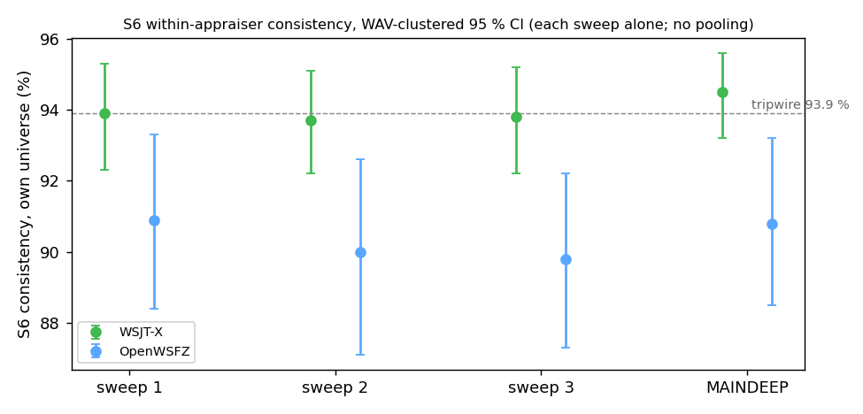

# DI7COH2: side-by-side report of 3 sweeps on `sol`

Built by `qa/rr-study/linux/build_series_summary.py` from each sweep's own `report.md` and sidecar files. **Nothing is pooled and no new statistic is computed:** every figure is copied from the sweep's own report; the script asserts each one was found and that the depth and flag read-backs are VALID. The comparison column is `2026-10-19-b0e23bb-MAINDEEP-sweep1` (reference series MAINDEEP, same rig, a different build: the figures differ across a build change, so the comparison is descriptive and not a measurement of one change alone).

## Sweeps

| | sweep 1 | sweep 2 | sweep 3 | MAINDEEP |
|---|---|---|---|---|
| folder | `2026-10-22-b9a82a9-DI7COH2-sweep1` | `2026-10-22-b9a82a9-DI7COH2-sweep2` | `2026-10-23-b9a82a9-DI7COH2-sweep3` | `2026-10-19-b0e23bb-MAINDEEP-sweep1` |
| battery verdict | **PASS** | **MARGINAL** | **PASS** | **MARGINAL** |
| depth read-back (V-D) | VALID (9969 polls, Deep) | VALID (17925 polls, Deep) | VALID (9975 polls, Deep) | VALID (9992 polls, Deep) |
| fallback line (V-F) | VALID (668/668 cycles) | VALID (1199/1199 cycles) | VALID (668/668 cycles) | n/a (not in this series) |
| scenario attempts / failed | 10/0 | 13/3 | 10/0 | 10/0 |

## Section 6: S6 off-air replay, sequential, 180 plays

| figure | sweep 1 | sweep 2 | sweep 3 | MAINDEEP |
|---|---|---|---|---|
| WSJT-X consistency, own universe (%) | 93.9 [92.3, 95.3] | 93.7 [92.2, 95.1] | 93.8 [92.2, 95.2] | 94.5 [93.2, 95.6] |
| OpenWSFZ consistency, own universe (%) | 90.9 [88.4, 93.3] | 90.0 [87.1, 92.6] | 89.8 [87.3, 92.2] | 90.8 [88.5, 93.2] |
| OpenWSFZ consistency, legacy universe (%) | 93.0 [91.0, 94.9] | 92.4 [90.2, 94.4] | 92.2 [90.2, 94.0] | 93.5 [91.8, 95.2] |
| decodes per WAV, WSJT-X / OpenWSFZ | 19.19 / 14.53 | 19.27 / 14.41 | 19.21 / 14.50 | 19.35 / 13.53 |
| positive agreement (%) | 75.3 [72.8, 77.6] | 74.3 [71.7, 76.8] | 75.0 [72.5, 77.4] | 69.6 [66.5, 72.7] |
| SNR delta OpenWSFZ - WSJT-X (dB) | -2.34 [-2.79, -1.85] | -2.46 [-2.91, -1.98] | -2.37 [-2.82, -1.91] | -2.28 [-2.74, -1.79] |
| S6 validity | S6-V1 S6-V2 S6-V3 S6-V4 S6-V5 S6-V7 PASS; onset PASS | S6-V1 S6-V2 S6-V3 S6-V4 S6-V5 S6-V7 PASS; onset PASS | S6-V1 S6-V2 S6-V3 S6-V4 S6-V5 S6-V7 PASS; onset PASS | S6-V1 S6-V2 S6-V3 S6-V4 S6-V5 S6-V7 PASS; onset PASS |

## Battery summary rows (verdicts as the report states them)

| row | sweep 1 | sweep 2 | sweep 3 | MAINDEEP |
|---|---|---|---|---|
| %GR&R (%StudyVar) / S1 | 3.9% (%Contribution 0.1%, no verdict) (PASS) | 4.0% (%Contribution 0.2%, no verdict) (PASS) | 5.9% (%Contribution 0.4%, no verdict) (PASS) | 5.7% (%Contribution 0.3%, no verdict) (PASS) |
| %GR&R (%StudyVar) / S2 | 0.1% (%Contribution 0.0%, no verdict) (PASS) | 0.1% (%Contribution 0.0%, no verdict) (PASS) | 0.1% (%Contribution 0.0%, no verdict) (PASS) | 0.1% (%Contribution 0.0%, no verdict) (PASS) |
| %GR&R (%StudyVar) / S3 | 8.7% (%Contribution 0.8%, no verdict) (PASS) | 10.0% (%Contribution 1.0%, no verdict) (MARGINAL) | 8.6% (%Contribution 0.7%, no verdict) (PASS) | 10.7% (%Contribution 1.1%, no verdict) (MARGINAL) |
| FP event rate (95% UB), Gate A-W / S5/OpenWSFZ | 0/480 slots (event 0.000%; 95% UB 0.622%) (PASS) | 0/480 slots (event 0.000%; 95% UB 0.622%) (PASS) | 0/480 slots (event 0.000%; 95% UB 0.622%) (PASS) | 0/480 slots (event 0.000%; 95% UB 0.622%) (PASS) |
| FP event rate change, Gate A-Δ / S5/OpenWSFZ | 0/120 vs 0/360 (Fisher p=1.0000) (PASS) | 0/120 vs 0/360 (Fisher p=1.0000) (PASS) | 0/120 vs 0/360 (Fisher p=1.0000) (PASS) | 0/120 vs 0/360 (Fisher p=1.0000) (PASS) |
| FP events, Check B (narrowband) / S5/OpenWSFZ | 0/60 slots (FAIL iff >= 2) (PASS) | 0/60 slots (FAIL iff >= 2) (PASS) | 0/60 slots (FAIL iff >= 2) (PASS) | 0/60 slots (FAIL iff >= 2) (PASS) |
| FP events, Check B (narrowband) / S5/WSJT-X | 0/60 slots (FAIL iff >= 2) (PASS) | 0/60 slots (FAIL iff >= 2) (PASS) | 0/60 slots (FAIL iff >= 2) (PASS) | 0/60 slots (FAIL iff >= 2) (PASS) |
| Kappa (advisory) / OpenWSFZ_vs_truth | 0.955 (PASS) | 0.955 (PASS) | 0.955 (PASS) | 0.909 (PASS) |
| Kappa (advisory) / WSJT-X_vs_truth | 0.955 (PASS) | 0.955 (PASS) | 0.955 (PASS) | 0.955 (PASS) |
| Kappa (advisory) / between_appraisers | 1.000 (PASS) | 1.000 (PASS) | 1.000 (PASS) | 0.954 (PASS) |
| SNR bias / S1/OpenWSFZ | +0.85 dB (PASS) | +0.88 dB (PASS) | +1.42 dB (PASS) | +1.38 dB (PASS) |
| SNR bias / S1/WSJT-X | +0.82 dB (PASS) | +0.85 dB (PASS) | +0.85 dB (PASS) | +0.85 dB (PASS) |
| ndc / S1 | 36 (PASS) | 35 (PASS) | 23 (PASS) | 24 (PASS) |
| ndc / S2 | 1536 (PASS) | 1536 (PASS) | 1536 (PASS) | 1536 (PASS) |
| ndc / S3 | 16 (PASS) | 14 (PASS) | 16 (PASS) | 13 (PASS) |
| coverage rows all PASS | 16 rows, all PASS | 16 rows, all PASS | 16 rows, all PASS | 16 rows, all PASS |

## Other scenarios (informational)

| figure | sweep 1 | sweep 2 | sweep 3 | MAINDEEP |
|---|---|---|---|---|
| S1b decode rate WSJT-X / OpenWSFZ | 66.67% / 75.00% | 75.00% / 75.00% | 66.67% / 75.00% | 75.00% / 50.00% |
| S7 recovery, all families, WSJT-X / OpenWSFZ | 97.21% / 83.26% | 97.21% / 81.86% | 98.14% / 81.86% | 97.21% / 83.26% |
| S7 co-channel family, WSJT-X / OpenWSFZ | 100.00% / 57.14% | 100.00% / 57.14% | 100.00% / 48.57% | 100.00% / 54.29% |
| S8 band scene, WSJT-X / OpenWSFZ | 91.67% / 88.33% | 91.67% / 88.33% | 91.67% / 90.00% | 91.67% / 90.00% |

## Capture and timing counters (F2)

| figure | sweep 1 | sweep 2 | sweep 3 | MAINDEEP |
|---|---|---|---|---|
| channel drops (daemon log) | 1 | 1 | 1 | 0 |
| clamped grid windows (daemon log) | 2 | 11 | 5 | 0 |
| plays with a clamped cycle | 2 | 10 | 5 | 0 |
| placebo check (amendment 1) | inside the placebo: not flagged (without the clamped WAVs: +0.38 pp) | inside the placebo: not flagged (without the clamped WAVs: +0.93 pp) | inside the placebo: not flagged (without the clamped WAVs: +0.41 pp) | no clamp fell on a play of S6 pass O: recorded, check not owed |
| residual pass, last daemon: n / median / p90 / max ms, abandoned | 179 / 3084 / 5052 / 6236, 0 | 178 / 3064 / 5192 / 6288, 0 | 178 / 3060 / 4933 / 7058, 0 | 179 / 3022 / 4900 / 6413, 0 |

Bar for the residual pass: median <= 4,000 ms and 0 abandoned. The Architect closed the clamp look on 2026-10-23 (board, "DI7COH2 CLAMP LOOK"): keep reporting clamp counts and the placebo row; reopen only if clamps fall outside the placebo or the station shows one (the DI7COH-E station run had 0 clamps and 0 channel drops over 12 h).

## Reading rules

- The series is its own era row (DI7COH: `decoding_improvement` synced with `main`, fallback ON, Deep, `nhard` 24). Never pooled with MAINDEEP, TPDEEP, TPNORMAL, B2CAP, B2BASE or any concurrent S6.
- The WSJT-X tripwire is the Architect's (ruling 2026-10-17-2218): FLAG iff the WAV-clustered 95 % CI of the WSJT-X consistency excludes 93.9 %. It is a check on the rig, not a result about OpenWSFZ.
- Sampler rows (audio-setup) are PARTIAL on `sol` by construction (the Windows worker cannot run there).
