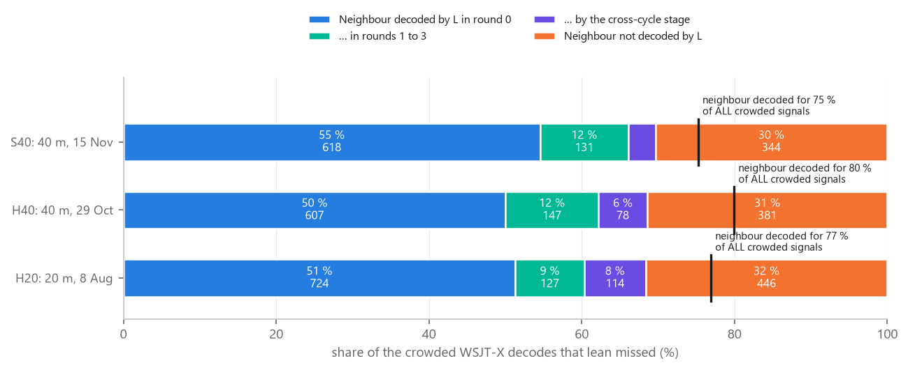
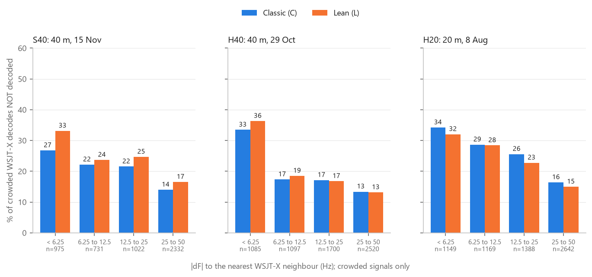
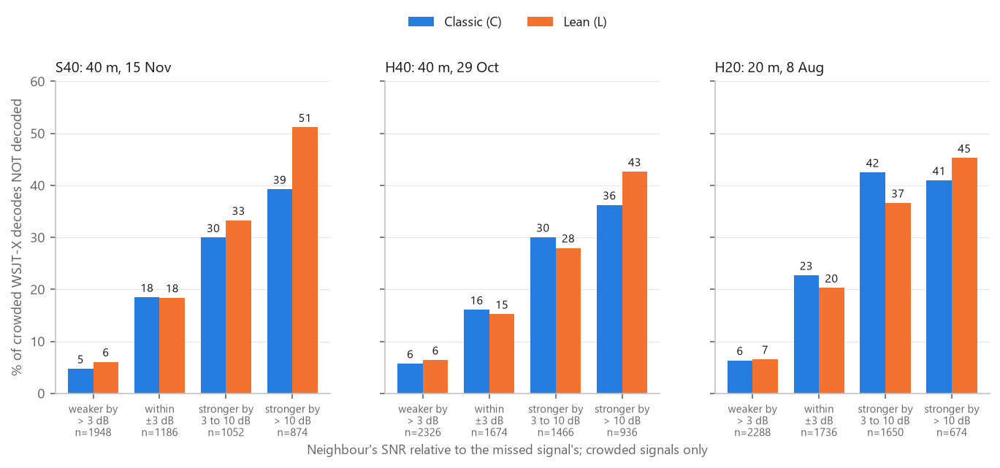
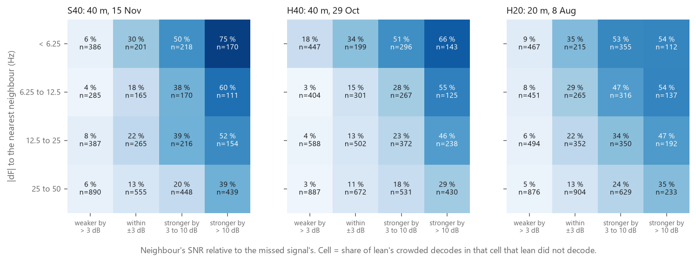

# CS-MAP: what the crowded signals lean misses look like

**Date:** 2026-11-26 · **Author:** QA · **Spec:** `docs/decoder-rebuild/spec-cs-map-crowded-misses.md` (Architect, `arch/decoder-rebuild` `ef62c8cc`), "both at once" with DR-3 · **Status:** a measurement on LC-BASE's data on disk. **No replay, no build, no code change, no bars.** Aggregates only (NFR-021): the WSJT-X list is rebuilt with numbers only (SNR, DT, frequency), and the match status comes from the harness's numeric match lists, so no message text is read at all. Beside `lc-base-result.md`, whose slices and runs this uses (S40, H40, H20; arms C = classic, L = lean).

## Summary

1. **The key number: of the crowded WSJT-X decodes lean missed, 69.6 % (S40), 68.6 % (H40) and 68.4 % (H20) had their nearest WSJT-X neighbour decoded by lean** (789 of 1,133; 832 of 1,213; 965 of 1,411). By the spec's rule this is **high**: lean usually finds the neighbour and then does not recover the signal next to it, which points at the subtraction and retry rounds. About 78 %, 73 % and 75 % of those neighbours were found in round 0. (Figure 1, Table 1.)
2. **Read the key number with its base rate.** Lean decodes the nearest neighbour for 75.2 %, 79.9 % and 76.9 % of *all* crowded signals, so among the missed ones the neighbour is somewhat *less* often decoded than average (by 5.6, 11.3 and 8.5 pp). And the neighbour being decoded in round 0 protects the signal only a little: the miss share is 27.3 %, 21.2 % and 26.5 % when the neighbour was decoded in round 0 against 27.5 %, 29.7 % and 30.4 % when it was not (Table 2). So about two thirds of the misses have a decoded neighbour, and the other third lose both, but whether the neighbour is found separates the cases only weakly.
3. **The neighbour's relative strength is the dominant factor.** Lean misses **6 %** of crowded signals whose neighbour is weaker by more than 3 dB, 15 to 20 % within ±3 dB, 28 to 37 % when the neighbour is stronger by 3 to 10 dB, and **43 to 51 %** when it is stronger by more than 10 dB. **64 to 70 % of lean's crowded misses have a neighbour stronger by more than 3 dB** (70.3, 66.7, 64.4 %), and only 10 to 12 % have a weaker one. Among the misses whose neighbour lean did decode, **80 to 87 %** have a stronger neighbour (86.6, 80.9, 79.5 %): lean found the strong signal and failed to recover the weak one beside it. (Figures 2 and 3, Tables 3 and 6.)
4. **Closeness matters second.** The miss share is highest inside one tone spacing (32 to 36 % below 6.25 Hz) and falls to 13 to 17 % at 25 to 50 Hz. A neighbour that is both stronger (by more than 3 dB) and within 12.5 Hz accounts for 32.7 %, 32.2 % and 33.2 % of lean's crowded misses, and in the cell "stronger by more than 10 dB and below 6.25 Hz" lean misses 75 %, 66 % and 54 %. (Figure 4, Tables 4 and 7.)
5. **Classic has the same structure** (CM-4 holds: within 2.8 pp of lean in every distance band on H40 and H20, and within 6.4 pp in every strength band). The two differ most on S40, where classic misses less when the neighbour is much stronger (39.2 % against 51.1 %) and below 6.25 Hz (26.8 % against 33.1 %).
6. **Time offset has no consistent effect; the number of neighbours does** (n50 of 1: 15 to 17 % missed; 3 or more: 29 to 38 %).

*Figure 1. Each bar is 100 % of the crowded WSJT-X decodes that lean missed in the slice. Blue, green and violet: the nearest neighbour was decoded by lean in round 0, in rounds 1 to 3 and by the cross-cycle stage; orange: it was not decoded. The black tick is the share of ALL crowded signals whose neighbour lean decoded (the base rate).*

## 1. What was computed

For every WSJT-X decode **T** in a slice, its **nearest neighbour N**: the other WSJT-X decode in the same cycle with the smallest absolute frequency difference (ties to the lower list index). **dF** = f(N) − f(T) (Hz); **dSNR** = SNR(N) − SNR(T) (WSJT-X's field); **dDT** = DT(N) − DT(T) (s); **n50** = the number of other WSJT-X decodes within ±50 Hz of T. Only **crowded** T are tabulated (n50 ≥ 1, the same definition as LC-BASE). A signal is **missed by L** (or C) if it was not matched by that arm under LC-BASE's rule (same text, same cycle, within 10 Hz, one-to-one). Bins: the spec's.

**Checks against LC-BASE (asserted in the code):** the number of crowded decodes is 5,060, 6,402 and 6,348, i.e. 74.7 %, 71.3 % and 69.3 % of the WSJT-X decodes of S40 (6,773), H40 (8,983) and H20 (9,154), as LC-BASE §3.2 gives; lean's crowded misses are 1,133, 1,213 and 1,411, equal to LC-BASE's Tables 3a to 3c (C only + neither, crowded rows, summed over the SNR bands).

## 2. The key number

**Table 1.**

| Slice | Crowded WSJT-X decodes | Missed by L | of those, nearest neighbour decoded by L | Share | by batch 1 / 2 / 3 | For comparison: neighbour decoded by L over ALL crowded decodes |
|---|---:|---:|---:|---:|---:|---:|
| S40 | 5060 | 1133 | 789 | **69.6 %** | 618 / 131 / 40 | 75.2 % |
| H40 | 6402 | 1213 | 832 | **68.6 %** | 607 / 147 / 78 | 79.9 % |
| H20 | 6348 | 1411 | 965 | **68.4 %** | 724 / 127 / 114 | 76.9 % |

**Table 2: miss share by whether the neighbour was decoded by lean** (all crowded signals).

| Neighbour | S40 n | S40 L miss % | S40 C miss % | H40 n | H40 L miss % | H40 C miss % | H20 n | H20 L miss % | H20 C miss % |
|---|---:|---:|---:|---:|---:|---:|---:|---:|---:|
| Neighbour decoded by L, round 0 (batch 1) | 2262 | 27.3 | 23.7 | 2859 | 21.2 | 21.8 | 2735 | 26.5 | 29.8 |
| Neighbour decoded by L, rounds 1 to 3 (batch 2) | 1414 | 9.3 | 10.0 | 2045 | 7.2 | 9.0 | 1832 | 6.9 | 10.5 |
| Neighbour decoded by L, cross-cycle (batch 3) | 131 | 30.5 | 21.4 | 214 | 36.4 | 31.8 | 315 | 36.2 | 34.6 |
| Neighbour not decoded by L | 1253 | 27.5 | 21.1 | 1284 | 29.7 | 23.8 | 1466 | 30.4 | 27.3 |
| **all crowded** | **5060** | **22.4** | **19.2** | **6402** | **18.9** | **18.4** | **6348** | **22.2** | **23.9** |

*The "rounds 1 to 3" row is low (7 to 9 %) by construction as much as by effect: a signal and its neighbour that are both decoded after subtraction were found together, so a neighbour found in rounds 1 to 3 says little about whether subtraction helps.*

## 3. By distance and by relative strength

*Figure 2. Share of the crowded WSJT-X decodes that each engine did not decode, by the absolute frequency distance to the nearest neighbour.*

**Table 3a: by distance.**

| \|dF\| (Hz) | S40 n | S40 L miss % | S40 C miss % | H40 n | H40 L miss % | H40 C miss % | H20 n | H20 L miss % | H20 C miss % |
|---|---:|---:|---:|---:|---:|---:|---:|---:|---:|
| < 6.25 | 975 | 33.1 | 26.8 | 1085 | 36.3 | 33.5 | 1149 | 32.0 | 34.2 |
| 6.25 to 12.5 | 731 | 23.7 | 22.2 | 1097 | 18.5 | 17.3 | 1169 | 28.4 | 28.7 |
| 12.5 to 25 | 1022 | 24.7 | 21.5 | 1700 | 16.8 | 17.1 | 1388 | 22.8 | 25.6 |
| 25 to 50 | 2332 | 16.5 | 14.0 | 2520 | 13.1 | 13.4 | 2642 | 15.0 | 16.4 |
| **all crowded** | **5060** | **22.4** | **19.2** | **6402** | **18.9** | **18.4** | **6348** | **22.2** | **23.9** |

*Figure 3. The same, by the neighbour's SNR relative to the missed signal's.*

**Table 3b: by relative strength.**

| Neighbour's SNR minus T's | S40 n | S40 L miss % | S40 C miss % | H40 n | H40 L miss % | H40 C miss % | H20 n | H20 L miss % | H20 C miss % |
|---|---:|---:|---:|---:|---:|---:|---:|---:|---:|
| weaker by > 3 dB | 1948 | 6.1 | 4.7 | 2326 | 6.4 | 5.7 | 2288 | 6.6 | 6.3 |
| within ±3 dB | 1186 | 18.4 | 18.5 | 1674 | 15.2 | 16.1 | 1736 | 20.3 | 22.7 |
| stronger by 3 to 10 dB | 1052 | 33.3 | 29.9 | 1466 | 28.0 | 30.0 | 1650 | 36.6 | 42.5 |
| stronger by > 10 dB | 874 | 51.1 | 39.2 | 936 | 42.6 | 36.2 | 674 | 45.3 | 40.9 |
| **all crowded** | **5060** | **22.4** | **19.2** | **6402** | **18.9** | **18.4** | **6348** | **22.2** | **23.9** |

## 4. Distance and strength together (lean)

*Figure 4. Lean's crowded decodes by |dF| (rows) and the neighbour's relative strength (columns): share not decoded, with the number of decodes in the cell.*

**Table 4 (per slice): number of crowded decodes / share missed by lean.**

S40:

| \|dF\| (Hz) | weaker by > 3 dB | within ±3 dB | stronger by 3 to 10 dB | stronger by > 10 dB |
|---|---:|---:|---:|---:|
| < 6.25 | 386 / 6.2 % | 201 / 30.3 % | 218 / 50.5 % | 170 / 75.3 % |
| 6.25 to 12.5 | 285 / 3.9 % | 165 / 18.2 % | 170 / 38.2 % | 111 / 60.4 % |
| 12.5 to 25 | 387 / 8.0 % | 265 / 21.5 % | 216 / 38.9 % | 154 / 51.9 % |
| 25 to 50 | 890 / 5.8 % | 555 / 12.6 % | 448 / 20.3 % | 439 / 39.2 % |

H40:

| \|dF\| (Hz) | weaker by > 3 dB | within ±3 dB | stronger by 3 to 10 dB | stronger by > 10 dB |
|---|---:|---:|---:|---:|
| < 6.25 | 447 / 18.3 % | 199 / 33.7 % | 296 / 50.7 % | 143 / 66.4 % |
| 6.25 to 12.5 | 404 / 3.0 % | 301 / 15.3 % | 267 / 28.5 % | 125 / 55.2 % |
| 12.5 to 25 | 588 / 4.1 % | 502 / 12.9 % | 372 / 23.1 % | 238 / 46.2 % |
| 25 to 50 | 887 / 3.5 % | 672 / 11.5 % | 531 / 18.5 % | 430 / 29.1 % |

H20:

| \|dF\| (Hz) | weaker by > 3 dB | within ±3 dB | stronger by 3 to 10 dB | stronger by > 10 dB |
|---|---:|---:|---:|---:|
| < 6.25 | 467 / 9.4 % | 215 / 35.3 % | 355 / 53.0 % | 112 / 53.6 % |
| 6.25 to 12.5 | 451 / 7.8 % | 265 / 28.7 % | 316 / 46.5 % | 137 / 54.0 % |
| 12.5 to 25 | 494 / 5.9 % | 352 / 22.2 % | 350 / 34.0 % | 192 / 46.9 % |
| 25 to 50 | 876 / 4.8 % | 904 / 13.5 % | 629 / 23.8 % | 233 / 34.8 % |

## 5. Time offset and number of neighbours

**Table 5a: by |dDT|.**

| \|dDT\| | S40 n | S40 L miss % | S40 C miss % | H40 n | H40 L miss % | H40 C miss % | H20 n | H20 L miss % | H20 C miss % |
|---|---:|---:|---:|---:|---:|---:|---:|---:|---:|
| < 0.16 s | 2804 | 21.0 | 17.3 | 3279 | 20.9 | 19.4 | 3301 | 21.1 | 22.3 |
| 0.16 to 0.5 s | 1546 | 23.0 | 21.0 | 1823 | 17.7 | 17.6 | 1777 | 25.1 | 26.2 |
| > 0.5 s | 710 | 26.6 | 22.5 | 1300 | 15.7 | 17.3 | 1270 | 21.2 | 24.7 |
| **all crowded** | **5060** | **22.4** | **19.2** | **6402** | **18.9** | **18.4** | **6348** | **22.2** | **23.9** |

**Table 5b: by the number of other WSJT-X decodes within ±50 Hz.**

| Other WSJT-X decodes within ±50 Hz (n50) | S40 n | S40 L miss % | S40 C miss % | H40 n | H40 L miss % | H40 C miss % | H20 n | H20 L miss % | H20 C miss % |
|---|---:|---:|---:|---:|---:|---:|---:|---:|---:|
| 1 | 2520 | 16.6 | 13.4 | 3714 | 15.3 | 13.8 | 3621 | 17.2 | 18.1 |
| 2 | 1691 | 25.7 | 21.0 | 1876 | 21.8 | 21.5 | 2004 | 25.7 | 28.8 |
| 3 or more | 849 | 33.0 | 32.6 | 812 | 28.8 | 32.6 | 723 | 37.8 | 38.9 |
| **all crowded** | **5060** | **22.4** | **19.2** | **6402** | **18.9** | **18.4** | **6348** | **22.2** | **23.9** |

- **dDT:** lean's miss share is 21.0, 23.0 and 26.6 % on S40 but 20.9, 17.7 and 15.7 % on H40 and 21.1, 25.1 and 21.2 % on H20: no consistent effect (a signal whose neighbour is a symbol away in time is not easier or harder in these data).
- **n50:** the miss share grows with the number of neighbours (lean: 16.6, 25.7, 33.0 % on S40; 15.3, 21.8, 28.8 % on H40; 17.2, 25.7, 37.8 % on H20).

## 6. Against the Architect's expectations (spec §5)

| # | Prediction | Measured | |
|---|---|---|---|
| CM-1 | On H40 and H20, more than half of the crowded T that L missed have their nearest neighbour decoded by L | 68.6 % (H40), 68.4 % (H20) | **Hit** |
| CM-2 | On H40 and H20, in more than half of those misses the neighbour is stronger (dSNR > +3 dB) | all crowded misses: 66.7 % (H40), 64.4 % (H20); only the misses whose neighbour L decoded: 80.9 % and 79.5 % | **Hit** (on either reading of "those") |
| CM-3 | L's miss share is highest at \|dF\| < 12.5 Hz and falls with \|dF\|, on all three slices | highest below 6.25 Hz on all three; falls monotonically on H40 (36.3, 18.5, 16.8, 13.1 %) and H20 (32.0, 28.4, 22.8, 15.0 %); **S40 rises by 1.0 pp between the second and third band** (33.1, 23.7, 24.7, 16.5 %) | **Hit on H40 and H20; on S40 a strict reading fails by 1.0 pp** |
| CM-4 | C's miss shares follow L's within 5 pp in every \|dF\| band on H40 and H20 | largest difference 2.8 pp (H40 below 6.25 Hz: 36.3 against 33.5 %; H20 12.5 to 25 Hz: 22.8 against 25.6 %) | **Hit** |

## 7. What this suggests (not a ruling)

- On the spec's own rule the key number is **high** (68 to 70 %), which favours work on what happens after lean finds the strong signal: the subtraction and the retry rounds (does the strong signal come off cleanly, and is the weak one found afterwards, under the `kMinScorePass2` threshold of the residual search).
- The data add two pieces of structure that a change should be judged against: the problem is overwhelmingly **a weaker signal beside a stronger one** (64 to 70 % of misses; 80 to 87 % of those where lean did find the neighbour), and it grows steeply as the neighbour gets stronger and closer.
- **The caveat on the key number:** whether the neighbour was decoded in round 0 lowers the miss share only by 0.2, 8.5 and 3.9 pp (27.5 to 27.3 %, 29.7 to 21.2 %, 30.4 to 26.5 %; Table 2). If the subtraction route is right, the gain should show up first in the cells with a strong neighbour (Table 4), which hold about a third of lean's crowded misses.
- **Not examined:** whether the neighbour was subtracted well or poorly, and what the missed signal's sync score was after subtraction. Neither is in the data on disk.

## 8. Not claimed, and caveats

- **Data on disk only:** one run per arm per slice, no confidence intervals (the minimal-test rule). S40's classic arm is DR-0's A6 on the shipped build, its lean arm DR-2e's L5; H40 and H20 are LC-BASE's runs.
- **The nearest neighbour only:** a signal with two close neighbours is described by the nearer one; n50 (Table 5b) shows how many there are.
- **Crowding is measured from WSJT-X's decodes only:** a signal WSJT-X did not decode is invisible, so real crowding is higher than measured and the signals beside T may be more numerous or stronger than listed.
- **Frequencies are integer Hz** (WSJT-X's field), so the bin edge at 6.25 Hz splits 6 Hz from 7 Hz; the |dF| < 6.25 Hz bin holds dF of 0 to 6 Hz.
- **Bin edges:** a dSNR of exactly +3 or −3 dB is in the "within ±3 dB" bin; +10 dB is in "stronger by 3 to 10 dB".
- **Selection:** a signal decoded together with its neighbour after subtraction is counted as "neighbour decoded in rounds 1 to 3" (Table 2); read that row as a selection effect.

## 9. Files

- **This report and its figures:** `qa/rr-study/results/2026-11-26-lc-base/cs-map-result.md`, `cs-map-figures/` and `cs_map.json` (counts only).
- **Scripts:** `qa/decoder-rebuild/cs_map.py` (the computation) and `cs_map_report.py` (figures, tables and this document).
- **Input:** LC-BASE's run data (`_qa-scratch\lc-base\runs\full_*`, DR-0's `full_A6_n170` and DR-2e's `threads16_L5_n170`, KEEP) and each night's `wsjt-x/ALL.TXT`; the per-row files hold message text and are never committed (HK-037).
