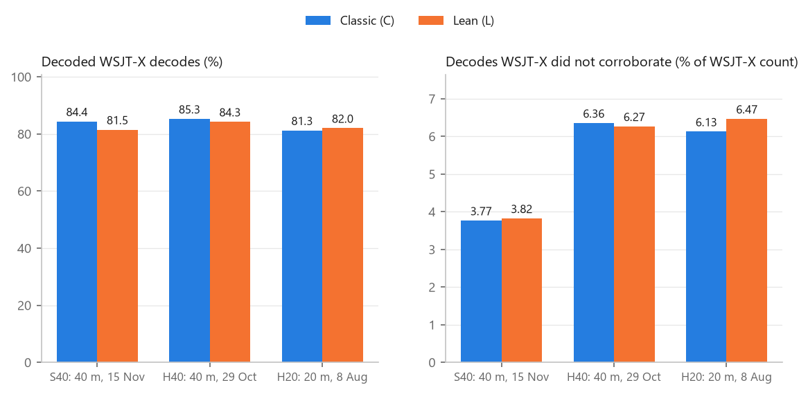
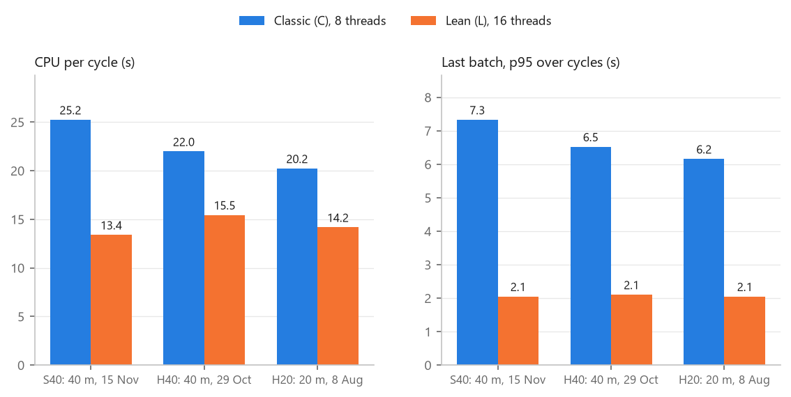
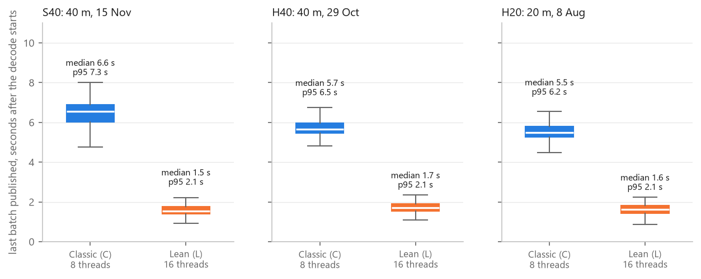
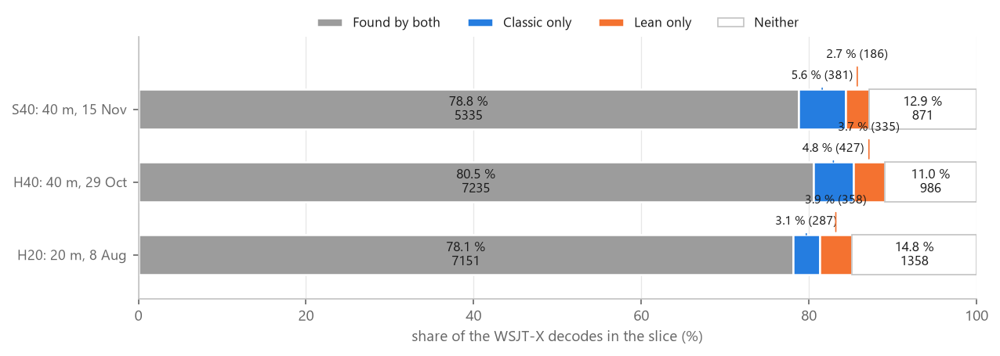
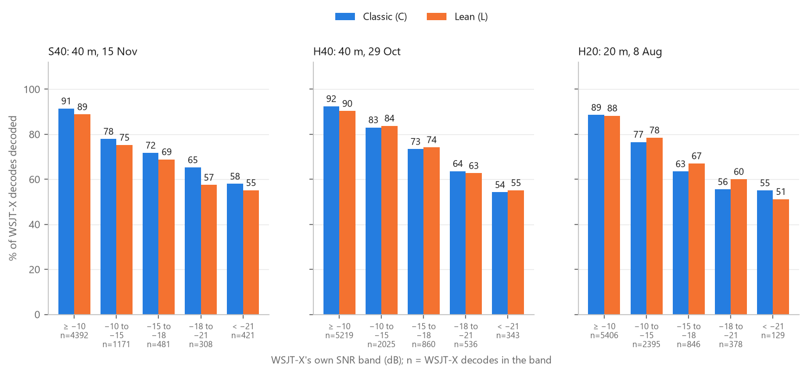
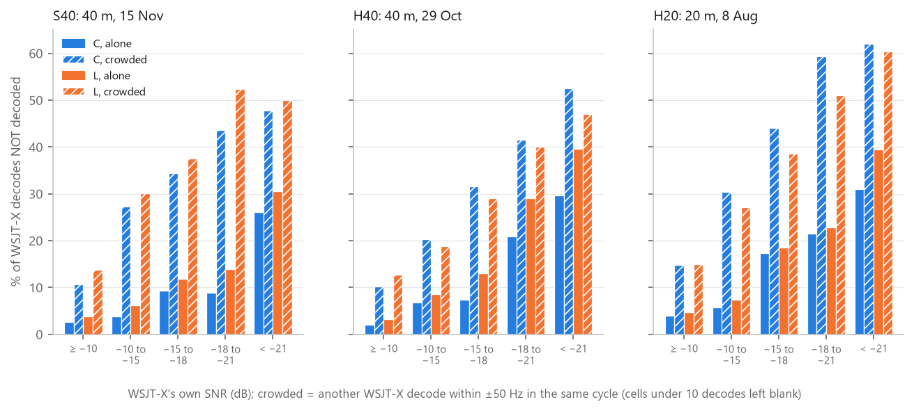
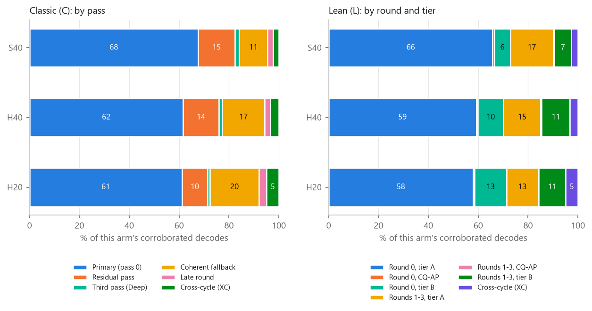
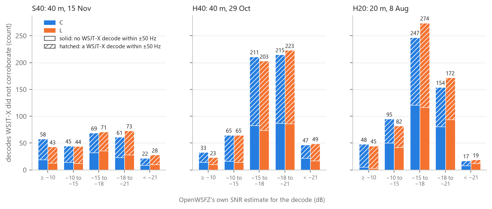
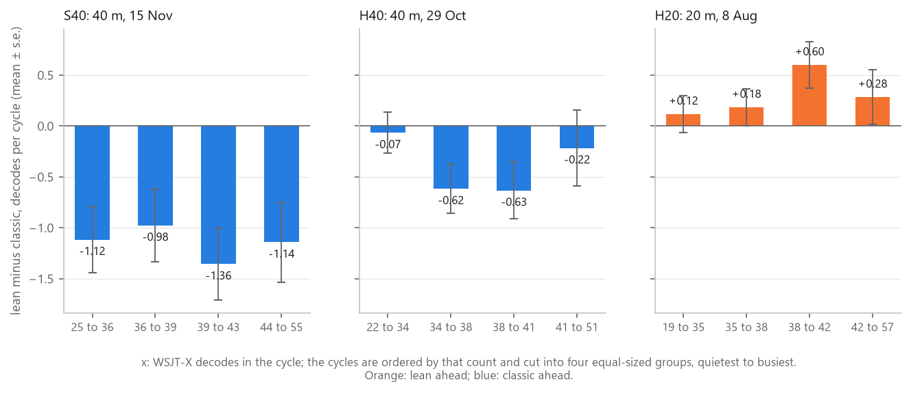

# LC-BASE: where the lean decoder stands against the classic one (recorded audio)

**Date:** 2026-11-26 · **Author:** QA · **Spec:** `docs/decoder-rebuild/spec-lc-base-lean-vs-classic.md` (Architect, `arch/decoder-rebuild` `8bf4d668`), approved by the Captain 2026-11-26 · **Status:** a measurement. No bars, no verdict, no ruling needed (spec §5.3). Aggregates only (NFR-021): no message text, callsign or audio is in this report.

## Summary

1. **Decode rate: the two engines are close, and which one is ahead depends on the night.** Against WSJT-X on the same audio, lean is **2.88 pp behind on S40** (40 m, 15 Nov), **1.02 pp behind on H40** (40 m, 29 Oct) and **0.78 pp ahead on H20** (20 m, 8 Aug). Counted per cycle, the mean gap is −1.15 ± 0.18, −0.38 ± 0.14 and +0.30 ± 0.11 decodes (mean ± standard error over 170, 240 and 240 cycles): at most about one decode per cycle either way. (Figure 1, Table 1.)
2. **Cost: lean is much cheaper and much faster.** CPU per cycle is **47 %, 30 % and 30 % lower** (13.4, 15.5, 14.2 against 25.2, 22.0, 20.2 CPU-s), although lean ran with 16 threads and classic with 8. **These CPU figures are for lean at 16 threads and classic at 8**: at 2 threads lean used 9.90 CPU-s per cycle on S40 (DR-2e) and classic used 3.97 CPU-s less than at 8 (DR-0's A9), so the saving depends on the thread count for both engines and is not a fixed property of either. The last batch is published at a p95 of **2.05 to 2.11 s against 6.2 to 7.3 s**. No cycle was abandoned in any run. (Figure 2.)
3. **False side: equal.** Decodes WSJT-X did not corroborate differ by at most 0.34 pp of the WSJT-X count (Table 1, Figure 7).
4. **The room for improvement is the same for both engines: crowded signals.** 11.0 to 14.8 % of the WSJT-X decodes are found by **neither** engine (871, 986 and 1,358 decodes). **86 to 91 % of lean's misses are crowded (a WSJT-X decode within ±50 Hz), against 69 to 75 % of all WSJT-X decodes; a crowded signal is missed 1.2 to 7.1 times as often as an isolated one of the same SNR band (median 3.1 times).** The ratio is the finding; the 86 to 91 % alone overstates it. Of everything lean misses, **59 to 70 % are stronger than −15 dB**; only 13 to 26 % are weaker than −18 dB. (Figures 3 and 5, Tables 2 and 3.)
5. **Where the engines differ:** classic keeps an edge on **isolated** signals (found by classic only: 32, 71, 42; by lean only: 1, 11, 8) and, on both 40 m slices, on **strong crowded** signals (≥ −10 dB, crowded: classic only 175 and 165, lean only 74 and 73). Lean has the edge on **weak crowded** signals (below −10 dB) on H40 (251 against 191) and H20 (237 against 128), but not on S40 (111 against 174). (Figure 4, Table 3.)
6. **One thing in lean's false side to look at:** on S40 and H40 lean published 14 and 10 decodes whose text WSJT-X decoded in the same cycle at a *different* frequency; classic published none, on any slice (Table 5). **All 24 sit 98 to 103 Hz below WSJT-X's decode of the same text (none above) and all come from round 0, tier A** (section 5.1): they look like genuine decodes reported about 100 Hz from where they are, which would count each one twice against lean.

*Figure 1. Left: the share of WSJT-X's decodes that each engine also decoded (`rate`). Right: decodes WSJT-X did not corroborate, as a share of the WSJT-X count (`ours_only`). Values are in Table 1.*

## 1. What was run

| | |
|---|---|
| **Arms** | **C** = classic, DR-0's A6 flags exactly (`--mode three1 --cohfb 1 --late-round 1 --xc-prior 1`, the common flags, `--threads 8`, `--engine classic`). **L** = lean, DR-2e's L5 (the same flags plus `--engine lean --lean-threads 16 --effort normal`). Lean decodes are identical at every thread count (measured at 2, 4, 8, 16 on S40). |
| **Harness and build** | `Ft8.FitProbe.exe` (the replay harness, `-p:HasLean=true`) built from merged `main` **`546ad125`** (PR #291), checkout `_qa-scratch\lc-base\tree`, binaries `_qa-scratch\lc-base\bin`. **`libft8.dll` SHA-256 actual = pinned = `eab11ec9a456169b96bde734ef319e8b74555acea4c09f9096661f6082190ea2`**, asserted by the runner before and after every run (shim 20260078; the same file as `feat/threads-default-auto` `9027616e`). |
| **`--filter`** | None: this is a replay, not a test run. Nothing was filtered out. |
| **Slices** | **S40** 40 m, night `20261114_2312`, 170 cycles from `261115_072930`, 6,773 WSJT-X decodes: **reused, not re-run** (spec §3): arm C = DR-0's A6 (`dr0\full_A6_n170`, shipped build `66b3ddf1`), arm L = DR-2e's L5 (`dr2e\threads16_L5_n170`, `fc4fb788`). **H40** 40 m, night `20261028_2233`, 240 cycles `261029_021045` to `261029_031030`, 8,983 WSJT-X decodes (the window `test-set.md` recorded, reproduced by the search). **H20** 20 m, night `20260808_live_run_0016-8080`, 240 cycles `260808_001730` to `260808_011715`, 9,154 WSJT-X decodes (the busiest 240 contiguous cycles, all WAVs present, found with the same per-cycle count of `ALL.TXT` stamps as `test-set.md`). The nights of 18 and 19 November were not touched. |
| **Audio and scoring** | `owsfz/wav/` of each night against that night's `wsjt-x/ALL.TXT`; warm-up cycle = the one before the window. A decode of ours is corroborated iff WSJT-X decoded the same text in the same cycle within 10 Hz, paired one-to-one, nearest first (the harness's standing rule, as in DR-0). `rate` = matched / WSJT-X decodes; `ours_only` = (ours − matched) / WSJT-X decodes; `cpu_net` = harness process CPU (user + kernel) per cycle; `last_p95` = p95 over cycles of the time the last batch was published. |
| **Pilot and reproduction check (spec §4)** | 10 cycles of each arm on H40 and H20, plus 10 cycles of C on S40. **C on S40, first 10 cycles on the new build: ours 344, matched 318; A6's first 10 cycles (DR-0 output, counted by code): ours 344, matched 318. Equal**, so the classic path of this build is A6's. The pilot read the August WAVs without problems and projected 57 min for the four runs, under the 100 min limit, so every slice ran the full 240 cycles. |
| **Conditions** | The four runs were strictly sequential on the station PC (8 cores, 16 logical processors) with nothing else heavy running (the runner refuses to start otherwise), 2026-11-26 17:26Z to 18:26Z. |

**Table 0: the runs.**

| Slice | Arm | Engine | Build | Cycles | Wall (s) | Process CPU (s) | Exit code |
|---|---|---|---|---:|---:|---:|---:|
| S40 | C | classic, 8 threads | shipped `66b3ddf1` (DR-0's A6) | 170 | 1,126.7 | 4,292.1 | 0 |
|  | L | lean, 16 threads | `fc4fb788` (DR-2e's L5) | 170 | 272.0 | 2,278.8 | 0 |
| H40 | C | classic, 8 threads | main `546ad125` | 240 | 1,385.8 | 5,276.2 | 0 |
|  | L | lean, 16 threads | main `546ad125` | 240 | 414.9 | 3,710.2 | 0 |
| H20 | C | classic, 8 threads | main `546ad125` | 240 | 1,332.2 | 4,856.1 | 0 |
|  | L | lean, 16 threads | main `546ad125` | 240 | 392.5 | 3,403.7 | 0 |

## 2. Headline

**Table 1** (S40 rows are the reused A6 and L5 figures, 170 cycles; H40 and H20 are measured here, 240 cycles).

| Slice | Arm | Cycles | WSJT-X decodes | matched | ours | rate % | ours_only % | cpu_net (CPU-s/cycle) | last_p95 (ms) | abandoned |
|---|---:|---:|---:|---:|---:|---:|---:|---:|---:|---:|
| S40 | C (classic) | 170 | 6773 | 5716 | 5971 | 84.39 | 3.77 | 25.25 | 7,332 | 0 |
|  | L (lean) |  | 6773 | 5521 | 5780 | 81.52 | 3.82 | 13.40 | 2,053 | 0 |
|  | **L − C** |  |  | -195 | -191 | **-2.88 pp** | +0.06 pp | -11.84 | -5,279 |  |
| H40 | C (classic) | 240 | 8983 | 7662 | 8233 | 85.29 | 6.36 | 21.98 | 6,527 | 0 |
|  | L (lean) |  | 8983 | 7570 | 8133 | 84.27 | 6.27 | 15.46 | 2,108 | 0 |
|  | **L − C** |  |  | -92 | -100 | **-1.02 pp** | -0.09 pp | -6.53 | -4,419 |  |
| H20 | C (classic) | 240 | 9154 | 7438 | 7999 | 81.25 | 6.13 | 20.23 | 6,162 | 0 |
|  | L (lean) |  | 9154 | 7509 | 8101 | 82.03 | 6.47 | 14.18 | 2,053 | 0 |
|  | **L − C** |  |  | 71 | 102 | **+0.78 pp** | +0.34 pp | -6.05 | -4,109 |  |

*Figure 2. Left: CPU seconds per cycle (the harness process). Right: p95 over cycles of the time the last batch was published after the decode started. Classic ran 8 threads, lean 16. The S40 classic figure is DR-0's A6, measured on another day and on the shipped build, so its CPU is not paired with the lean one in time; the H40 and H20 pairs ran back to back on one build.*

- **Rate.** The sign of the difference changes between slices, and its size is small next to the per-cycle spread. Taken per cycle (Figure 9), lean is behind by −1.15 ± 0.18 decodes on S40 and −0.38 ± 0.14 on H40 and ahead by +0.30 ± 0.11 on H20. These are standard errors of the per-cycle mean, given as a size of the spread, not as a significance test (one run per arm, no confidence interval, per the minimal-test rule).
- **The 20 m slice is not comparable in rate with the two 40 m slices.** It was recorded on 8 August, before today's audio routing (the spec's caveat). The C-against-L comparison on it is fair, since both arms read the same audio.
- **Latency.** Lean's last batch comes 4.1 to 5.3 s earlier at the p95 (Figure 8) and its spread is narrower; classic sits at 5.5 to 6.6 s median.

*Figure 8. Box = interquartile range, white bar = median, whiskers = the range without outliers. Labels give the median and the p95.*

## 3. Where the decodes differ

Every WSJT-X decode in a slice is either found by both engines, by classic only, by lean only, or by neither. The overlap is computed per WSJT-X decode from the harness's per-cycle match lists (`matched.csv`); the WSJT-X decode list is rebuilt from `ALL.TXT` exactly as the harness builds it, and the per-arm matched counts were asserted equal to the harness's own counts.

**Table 2: who found the WSJT-X decodes.**

| Slice | WSJT-X decodes | Found by both | Classic only | Lean only | Neither | WSJT-X-only for L (= C only + neither) |
|---|---:|---:|---:|---:|---:|---:|
| S40 | 6773 | 5335 (78.8 %) | 381 (5.6 %) | 186 (2.7 %) | 871 (12.9 %) | 1252 (18.5 %) |
| H40 | 8983 | 7235 (80.5 %) | 427 (4.8 %) | 335 (3.7 %) | 986 (11.0 %) | 1413 (15.7 %) |
| H20 | 9154 | 7151 (78.1 %) | 287 (3.1 %) | 358 (3.9 %) | 1358 (14.8 %) | 1645 (18.0 %) |

*Figure 3. Each bar is 100 % of the WSJT-X decodes in the slice.*

### 3.1 By SNR

SNR is WSJT-X's own field. Bands (dB): ≥ −10, −10 to −15, −15 to −18, −18 to −21, < −21; a decode at exactly −15 belongs to the "−15 to −18" band, and so on (lower edge included).

*Figure 4. Per SNR band, the share of WSJT-X decodes each engine decoded. The two engines follow each other closely; the differences are a few points, in different directions in different bands (Tables 3a to 3c).*

### 3.2 By crowding

**Crowded** = another WSJT-X decode in the same cycle within ±50 Hz of this one (this counts only signals WSJT-X decoded, so real crowding is higher than measured). **69 to 75 % of all WSJT-X decodes are crowded by this definition** (S40 74.7 %, H40 71.3 %, H20 69.3 %), so most misses being crowded must be read against that base rate. The relevant comparison is the miss rate inside each group:

*Figure 5. Share of WSJT-X decodes that the engine did not decode, per SNR band, for alone (solid) and crowded (hatched) decodes. Cells under 10 decodes are left blank. In all 30 cells (3 slices × 2 engines × 5 bands) crowded signals are missed more often than isolated ones: 1.2 to 7.1 times as often, median 3.1 times. This is the dominant structure in the data.*

Reading Table 3: for a signal stronger than −10 dB, lean misses 3.3 % of the isolated decodes on H40 and 12.7 % of the crowded ones; below −21 dB it misses 40 % of the isolated and 47 % of the crowded ones.

**Table 3a: S40 (170 cycles).**

| SNR band (dB) | Crowding | WSJT-X decodes | C decoded % | L decoded % | C only | L only | Neither | WSJT-X-only for L |
|---|---:|---:|---:|---:|---:|---:|---:|---:|
| ≥ −10 | alone | 1146 | 97.3 | 96.2 | 13 | 0 | 31 | 44 |
|  | crowded | 3246 | 89.3 | 86.2 | 175 | 74 | 273 | 448 |
| −10 to −15 | alone | 259 | 96.1 | 93.8 | 6 | 0 | 10 | 16 |
|  | crowded | 912 | 72.7 | 70.0 | 74 | 49 | 200 | 274 |
| −15 to −18 | alone | 118 | 90.7 | 88.1 | 3 | 0 | 11 | 14 |
|  | crowded | 363 | 65.6 | 62.5 | 35 | 24 | 101 | 136 |
| −18 to −21 | alone | 79 | 91.1 | 86.1 | 4 | 0 | 7 | 11 |
|  | crowded | 229 | 56.3 | 47.6 | 33 | 13 | 87 | 120 |
| < −21 | alone | 111 | 73.9 | 69.4 | 6 | 1 | 28 | 34 |
|  | crowded | 310 | 52.3 | 50.0 | 32 | 25 | 123 | 155 |
| **all** |  | 6773 | **84.4** | **81.5** | 381 | 186 | 871 | 1252 |

**Table 3b: H40 (240 cycles).**

| SNR band (dB) | Crowding | WSJT-X decodes | C decoded % | L decoded % | C only | L only | Neither | WSJT-X-only for L |
|---|---:|---:|---:|---:|---:|---:|---:|---:|
| ≥ −10 | alone | 1665 | 97.9 | 96.7 | 20 | 0 | 35 | 55 |
|  | crowded | 3554 | 89.8 | 87.3 | 165 | 73 | 288 | 453 |
| −10 to −15 | alone | 504 | 93.3 | 91.5 | 13 | 4 | 30 | 43 |
|  | crowded | 1521 | 79.6 | 81.2 | 86 | 110 | 200 | 286 |
| −15 to −18 | alone | 177 | 92.7 | 87.0 | 11 | 1 | 12 | 23 |
|  | crowded | 683 | 68.4 | 70.9 | 48 | 65 | 151 | 199 |
| −18 to −21 | alone | 134 | 79.1 | 70.9 | 15 | 4 | 24 | 39 |
|  | crowded | 402 | 58.5 | 60.0 | 34 | 40 | 127 | 161 |
| < −21 | alone | 101 | 70.3 | 60.4 | 12 | 2 | 28 | 40 |
|  | crowded | 242 | 47.5 | 52.9 | 23 | 36 | 91 | 114 |
| **all** |  | 8983 | **85.3** | **84.3** | 427 | 335 | 986 | 1413 |

**Table 3c: H20 (240 cycles).**

| SNR band (dB) | Crowding | WSJT-X decodes | C decoded % | L decoded % | C only | L only | Neither | WSJT-X-only for L |
|---|---:|---:|---:|---:|---:|---:|---:|---:|
| ≥ −10 | alone | 1668 | 96.0 | 95.3 | 14 | 2 | 64 | 78 |
|  | crowded | 3738 | 85.2 | 85.1 | 117 | 113 | 441 | 558 |
| −10 to −15 | alone | 681 | 94.3 | 92.7 | 13 | 2 | 37 | 50 |
|  | crowded | 1714 | 69.5 | 72.8 | 70 | 126 | 396 | 466 |
| −15 to −18 | alone | 237 | 82.7 | 81.4 | 5 | 2 | 39 | 44 |
|  | crowded | 609 | 56.0 | 61.4 | 36 | 69 | 199 | 235 |
| −18 to −21 | alone | 149 | 78.5 | 77.2 | 3 | 1 | 31 | 34 |
|  | crowded | 229 | 40.6 | 48.9 | 19 | 38 | 98 | 117 |
| < −21 | alone | 71 | 69.0 | 60.6 | 7 | 1 | 21 | 28 |
|  | crowded | 58 | 37.9 | 39.7 | 3 | 4 | 32 | 35 |
| **all** |  | 9154 | **81.3** | **82.0** | 287 | 358 | 1358 | 1645 |

- **Classic only against lean only, isolated signals:** classic is ahead in every band of every slice (totals 32 against 1, 71 against 11, 42 against 8). Lean gives up some isolated signals that classic decodes, most visibly below −18 dB on H40 (isolated decodes at −21 dB or weaker: classic 70.3 %, lean 60.4 %). The cause was not diagnosed.
- **Strong crowded signals (≥ −10 dB):** classic is ahead on both 40 m slices (175 against 74 on S40, 165 against 73 on H40) and level on 20 m (117 against 113).
- **Weak crowded signals (below −10 dB):** lean is ahead on H40 (251 lean-only against 191 classic-only) and on H20 (237 against 128), classic on S40 (174 against 111).
- **Found by neither:** of the 871, 986 and 1,358 decodes neither engine found, 90.0 %, 86.9 % and 85.9 % are crowded.

**Where lean's misses are** (WSJT-X decodes lean did not decode = classic only + neither: 1,252, 1,413 and 1,645):

| | S40 | H40 | H20 |
|---|---:|---:|---:|
| crowded | 90.5 % | 85.8 % | 85.8 % |
| stronger than −15 dB | 62.5 % | 59.2 % | 70.0 % |
| weaker than −18 dB | 25.6 % | 25.1 % | 13.0 % |

## 4. Where the decodes came from

Each corroborated decode carries the harness's tags: the batch it was published in, the path (0 = ordinary pass, 1 = residual, third-pass or late-round decode, 2 = coherent-fallback tier B, 3 = cross-cycle stage) and whether it was a CQ-AP decode. The lean engine publishes round 0 as batch 1 and rounds 1 to 3 together as batch 2, so **a split into rounds 1, 2 and 3 separately is not available** from the harness's output (spec §5.2 item 3: skipped, no code change).

*Figure 6. Share of each engine's corroborated decodes by the step that published them. Segments under 4 % carry no number; see Tables 4a and 4b.*

**Table 4a: lean (L), corroborated decodes by origin (count and share).**

| Slice | Round 0, tier A | Round 0, CQ-AP | Round 0, tier B | Rounds 1-3, tier A | Rounds 1-3, CQ-AP | Rounds 1-3, tier B | Cross-cycle (XC) | other |
|---|---:|---:|---:|---:|---:|---:|---:|---:|
| S40 | 3634 (65.8 %) | 39 (0.7 %) | 352 (6.4 %) | 951 (17.2 %) | 24 (0.4 %) | 378 (6.8 %) | 143 (2.6 %) | 0 |
| H40 | 4483 (59.2 %) | 50 (0.7 %) | 776 (10.3 %) | 1135 (15.0 %) | 27 (0.4 %) | 857 (11.3 %) | 242 (3.2 %) | 0 |
| H20 | 4348 (57.9 %) | 49 (0.7 %) | 965 (12.9 %) | 949 (12.6 %) | 20 (0.3 %) | 808 (10.8 %) | 370 (4.9 %) | 0 |

**Table 4b: classic (C), corroborated decodes by pass.**

| Slice | Primary (pass 0) | Residual pass | Third pass (Deep) | Coherent fallback | Late round | Cross-cycle (XC) |
|---|---:|---:|---:|---:|---:|---:|
| S40 | 3865 (67.6 %) | 846 (14.8 %) | 99 (1.7 %) | 643 (11.2 %) | 130 (2.3 %) | 133 (2.3 %) |
| H40 | 4715 (61.5 %) | 1104 (14.4 %) | 102 (1.3 %) | 1310 (17.1 %) | 168 (2.2 %) | 263 (3.4 %) |
| H20 | 4547 (61.1 %) | 768 (10.3 %) | 65 (0.9 %) | 1473 (19.8 %) | 224 (3.0 %) | 361 (4.9 %) |

- Round 0, tier A (lean) and the primary pass (classic) carry 58 to 68 % of each engine's decodes.
- Classic's **third pass (Deep)** publishes 1 to 2 % of its decodes (65 to 102 decodes per slice) and is its most expensive step (DR-0: +8.56 CPU-s per cycle for +7.32 pp on S40); lean has no counterpart. These two figures do not contradict each other: **the tags show which step published a decode, not what switching that step off would lose.** DR-0's step from A3 to A4 (Deep) also changes what the earlier passes and the fallback find, so the share of a tag and the marginal gain of a step measure different things.
- Lean's **tier B** (the coherent fallback) supplies 13 to 24 % of its decodes (round 0 and rounds 1 to 3 together: 13.2, 21.6 and 23.7 %), against 11 to 20 % for classic's fallback.
- **XC** supplies 2.6 to 4.9 % (lean) and 2.3 to 4.9 % (classic).

## 5. What WSJT-X did not corroborate (`ours_only`)

The SNR here is OpenWSFZ's own estimate (WSJT-X has no value for a decode it did not make); crowding is against WSJT-X's decodes in the same cycle. Counts of distinct (cycle, text) rows.

*Figure 7. Counts, stacked: solid = no WSJT-X decode within ±50 Hz; hatched = one within ±50 Hz. Totals are labelled.*

**Table 5.**

| Slice | Arm | ours_only | WSJT-X decoded the same text at another frequency | ≥ −10 (alone / crowded) | −10 to −15 (alone / crowded) | −15 to −18 (alone / crowded) | −18 to −21 (alone / crowded) | < −21 (alone / crowded) |
|---|---:|---:|---:|---:|---:|---:|---:|---:|
| S40 | C | 255 | 0 | 19 / 39 | 14 / 31 | 32 / 37 | 23 / 38 | 9 / 13 |
|  | L | 259 | 14 | 13 / 30 | 12 / 32 | 36 / 35 | 28 / 45 | 10 / 18 |
| H40 | C | 571 | 0 | 14 / 19 | 16 / 49 | 83 / 128 | 87 / 128 | 22 / 25 |
|  | L | 563 | 10 | 10 / 13 | 14 / 51 | 74 / 129 | 86 / 137 | 17 / 32 |
| H20 | C | 561 | 0 | 5 / 43 | 50 / 45 | 121 / 126 | 81 / 73 | 8 / 9 |
|  | L | 592 | 0 | 3 / 42 | 42 / 40 | 117 / 157 | 94 / 78 | 12 / 7 |

- The two engines' false sides are about the same size (Figure 7). 53 to 64 % of it is crowded, and most of it lies below −15 dB by our own estimate.
- **Lean only:** 14 rows on S40 and 10 on H40 are texts WSJT-X decoded in the same cycle at a *different* frequency (more than 10 Hz away from ours). Classic has none, on all three slices. This is small (0.21 and 0.11 % of the WSJT-X count), but it has a pattern.

### 5.1 The 24 same-text rows

Numbers only, read from the per-row files (`nc.tsv`) by code; the offset is lean's frequency minus the frequency of the nearest WSJT-X decode of the same text in the same cycle (`qa/decoder-rebuild/lc_base_sign.py`, which reads the text inside one function and prints counts only).

| Slice | Rows | Offset to WSJT-X's decode of the same text | Above / below WSJT-X | Origin | Our SNR estimate |
|---|---:|---|---|---|---|
| S40 | 14 | −98 to −103 Hz (median −101) | 0 above, **14 below** | all 14 round 0, tier A | −25 to −12 dB |
| H40 | 10 | −101 to −102 Hz (median −101) | 0 above, **10 below** | all 10 round 0, tier A | −21 to −18 dB |
| H20 | 0 | | | | |

Signed offsets, in Hz, with the number of rows: S40: −103 ×1, −102 ×2, −101 ×9, −99 ×1, −98 ×1; H40: −102 ×4, −101 ×6.

- **They are probably genuine decodes reported at the wrong frequency.** The text is a message WSJT-X also decoded in that cycle, and every offset is within 5 Hz of 100 Hz. If so, each row counts twice against lean: once in `ours_only` and once as a WSJT-X decode lean missed. Lean's rate on S40 and H40 would then be understated by up to 0.21 and 0.11 pp (14 / 6,773 and 10 / 8,983), and its `ours_only` overstated by the same amounts.
- **A fixed offset of about 100 Hz is not noise.** It points to something systematic in how round 0 reports a candidate's frequency in rare cases (a few tenths of a percent of lean's round-0 decodes on those two slices). **All 24 are below WSJT-X's frequency, none above**, so the offset has one direction. That is what the Architect's hypothesis predicts (round 0 decodes the real signal and a second copy about 100 Hz away, and lean's rule 6 keeps the lower of two same-text decodes, `ftz_decoder.c:455` on `main`, where classic keeps a different one); a mixed sign would have ruled it out. One direction does not by itself separate that hypothesis from other one-directional causes, and the cause was not investigated. It does not occur in classic.
- **This was not looked for in advance and is a pattern in 24 rows on two slices**, so it is a lead, not a defect report.

## 6. Does the gap depend on how busy the cycle was?

*Figure 9. Cycles ordered by the number of WSJT-X decodes in them and cut into four equal-sized groups (quietest to busiest). Bars are the mean difference in matched decodes per cycle (lean minus classic), with the standard error.*

The gap is **not a function of activity**: the four groups of each slice stay on the same side of zero, with no trend from the quietest to the busiest cycles.

## 7. Against the Architect's expectation (spec §6, written before the run)

| Expectation | Measured | |
|---|---|---|
| L about 2 to 4 pp below C on H40 | −1.02 pp | **Miss**: the gap is smaller than expected |
| L about 2 to 4 pp below C on H20 (the spec's "similar on H20" meant the same 2 to 4 pp gap) | +0.78 pp | **Miss**: lean is ahead |
| `ours_only` about equal | −0.09 pp (H40), +0.34 pp (H20) | **Hit** |
| Most of L's WSJT-X-only decodes are crowded signals | 85.8 % (H40), 85.8 % (H20) crowded | **Hit** (base rate of crowded decodes 71 % and 69 %; Figure 5 gives the miss rates) |
| … and signals weaker than about −18 dB | 25.1 % (H40), 13.0 % (H20) are weaker than −18 dB; **59.2 % and 70.0 % are stronger than −15 dB** | **Miss**: most of the misses are signals of ordinary strength that are crowded |

**Score: 2 of 5.** Both misses on the rate were too pessimistic about lean. No single localised cause shows in these tables; the dominant structure is crowding, and it is shared by both engines.

## 8. What this suggests (not a ruling)

- Lean is already a viable base for new decode-rate work on this evidence: within about one decode per cycle of classic on each slice, at 53 to 70 % of the CPU (at 16 threads; the saving depends on the thread count) and about a third of the latency.
- The headroom is the 11 to 15 % of WSJT-X decodes neither engine finds, which is overwhelmingly crowded and mostly of ordinary strength (≥ −15 dB). That points at how the decoder separates and decodes signals that overlap in frequency, not at weak-signal sensitivity.
- Two small lean-specific differences are worth a look before or alongside any new step: the isolated signals classic decodes and lean does not (Table 3), and the 24 rows that sit about 100 Hz from WSJT-X's decode of the same text, all from round 0, tier A (section 5.1), which may be a frequency-reporting defect in lean.
- A natural next measurement from the data already on disk: for the "neither" group, the distance and SNR difference to the nearest neighbouring WSJT-X decode (a number per decode, no text), to see how close the neighbour is when the decoder fails. Not done: outside this spec; the Architect will specify it with the next step.

## 9. Not claimed, and caveats

- **One run per arm per slice, no confidence intervals** (the minimal-test rule). The per-cycle standard errors in Figure 9 describe spread only.
- **S40 is reused.** Its classic arm is DR-0's A6 on the shipped build `66b3ddf1` (run 2026-11-24), its lean arm DR-2e's L5 on `fc4fb788`; the new build reproduces A6 exactly on the first 10 cycles, but S40's CPU and latency are not paired in time. H40 and H20 are the clean pairs: one build, back to back.
- **H20 predates today's audio routing** (recorded 2026-08-08); its rate against WSJT-X is not comparable with the 40 m slices.
- **SNR and crowding come from WSJT-X's decodes only.** A signal WSJT-X did not decode is invisible to the crowding measure.
- **The CPU saving is for lean at 16 threads against classic at 8.** At 2 threads lean used 9.90 CPU-s per cycle on S40 (DR-2e), so the saving is not a fixed property of lean. **Threads differ by design:** classic 8 (A6), lean 16 (L5). Lean's decodes do not depend on its thread count. Classic at 2 threads (DR-0's A9) used 3.97 CPU-s less per cycle and decoded 1.99 pp less than at 8 threads, so the thread count is not neutral for classic.
- **The harness's text dedup** is by (cycle, text); two decodes of the same text in one cycle count once.
- **No per-round split** for lean (see section 4).
- **Not examined:** the *reasons* for any difference (which classic step finds what lean misses); the scoring pairs by text, so pairing our rows between the two arms needs text and was not done.

## 10. Files

- **This report and its figures (committed):** `qa/rr-study/results/2026-11-26-lc-base/lc-base-result.md` and `figures/fig1` to `fig9`, with the aggregate data it was built from: `score_{reuse_S40,full_H40,full_H20}.json`, `tables.json`, `slices.json` and one `arm.json` per run under `runs/` (numbers only).
- **Scripts (committed):** `qa/decoder-rebuild/lc_base_prep.py` (slices), `lc_base_run.py` (runs), `lc_base_score.py` (scoring), `lc_base_report.py` (figures and tables), `lc_base_sign.py` (the sign of the 24 same-text rows, `sign_same_text.json`), `lc_base_assemble.py` (this document). The two new slices are recorded in `qa/decoder-rebuild/test-set.md`.
- **Run data (KEEP, text-bearing, never committed; HK-037):** `D:\Projects\claude\_qa-scratch\lc-base\runs\{pilot,full}_<slice>_<arm>_n<cycles>` (the `nc.tsv` files hold message text), score files `D:\Projects\claude\_qa-scratch\lc-base\score_*.json` (numbers only), harness checkout and build `D:\Projects\claude\_qa-scratch\lc-base\{tree,bin}`.
- **Aggregate-only copies of every run** (arm summaries, per-cycle timings, match lists as numeric indices, score files): `D:\Projects\claude\OpenWSFZ\qa\rr-study\results\2026-11-26-lc-base\` (the root results folder, standing rule; untracked there, so the tracked copy above is the one that travels with a push).
