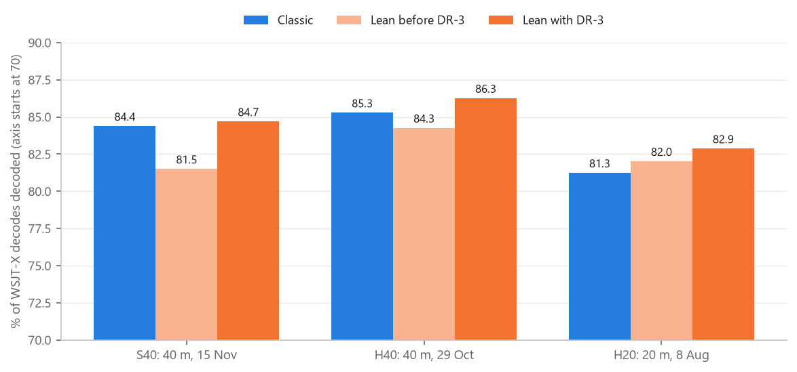
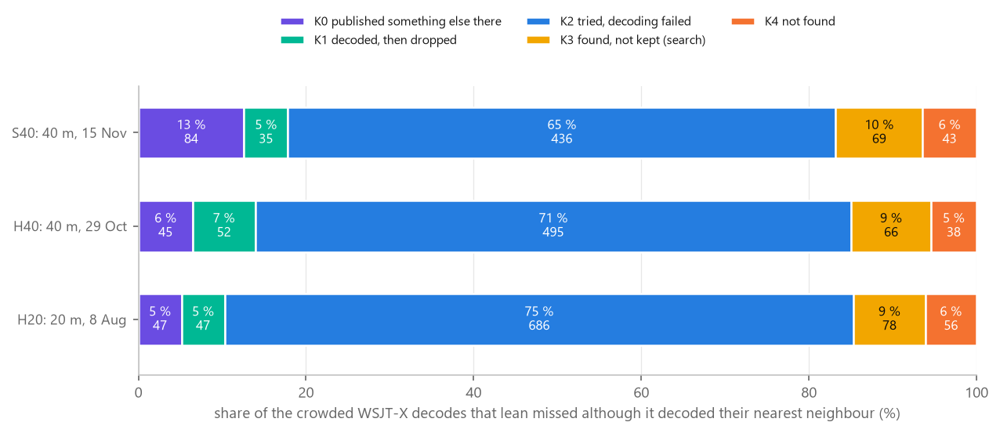
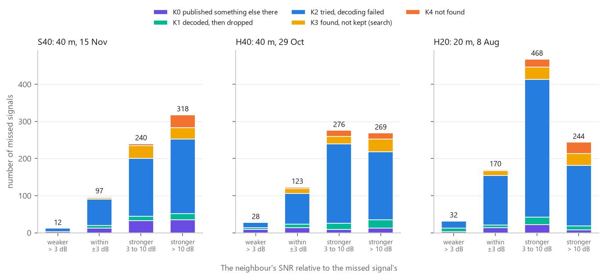
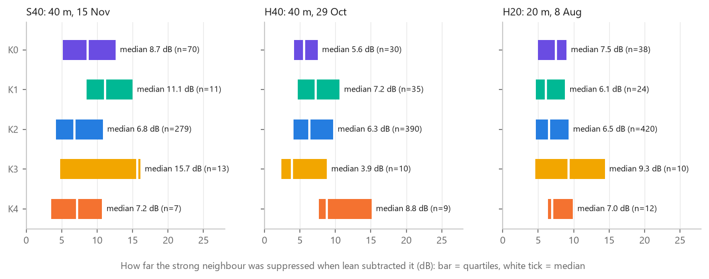
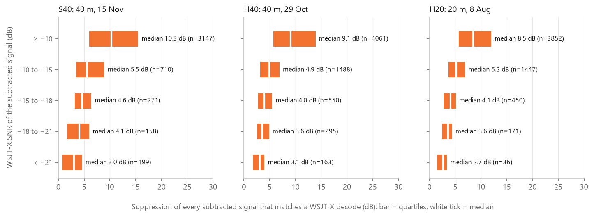
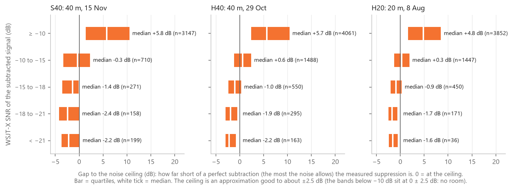

# SUB-PROBE: why lean misses a weak signal beside one it already decoded

**Date:** 2026-11-26 · **Author:** QA · **Spec:** `docs/decoder-rebuild/spec-sub-probe.md` (Architect, `arch/decoder-rebuild` `028ad6ac`); the Captain chose option A ("measure first") and "fold the baseline into the probe run" (2026-11-26) · **Status:** a measurement, no bars; it picks the first decoder change. Aggregates only (NFR-021): the probe rows carry no text; the WSJT-X list is rebuilt with SNR, DT and frequency only.

## Summary

1. **The probe changed nothing it should not.** S40 reproduces QA's DR-3 replay exactly: matched 5,737 and ours 6,009, equal in every cycle (the Architect's free check). On S40 the probe costs about 3 % extra CPU (14.48 against 14.11 CPU-s per cycle); no buffer overflow, abandoned cycle or native error occurred in any slice.
2. **DR-3's gain holds on all three slices, and lean is now ahead of classic everywhere.** The rate of lean rose by **+3.19, +2.00 and +0.85 pp** (S40, H40, H20), and lean with DR-3 is **+0.31, +0.98 and +1.63 pp above classic** (84.70 against 84.39, 86.27 against 85.29, 82.88 against 81.25 %). The false side grew by 0.10 to 0.55 pp. (Figure 1, Table 1.)
3. **Where the remaining crowded misses fail: mostly in decoding, not in the search.** Of the crowded WSJT-X decodes lean missed although it decoded their nearest neighbour, **65 %, 71 % and 75 % were K2: a candidate was found at that position and tried, but belief propagation or the coherent step failed.** Only **6 %, 5.5 % and 6 % were K4 (not found at all)**; K3 (found only by the floor-0 search or filtered out) is 8.5 to 10 %, K1 (decoded, then dropped) 5 to 7.5 %, K0 (lean published a different decode at that position) 5 to 13 %. (Figure 2, Table 3.)
4. **Subtraction: complete for weak signals, incomplete for strong ones.** The raw suppression looks small (median **6.8, 6.3 and 6.5 dB for the K2 neighbours**; 8.0, 6.5 and 6.5 dB over all subtracted signals), but **a signal can only look suppressed by as much as it stood above the noise in its own footprint** (the "noise ceiling", about 8 dB for a −10 dB signal and 4 dB for a −15 dB one). Measured against that ceiling, **every signal weaker than −10 dB is removed down to the noise floor (gap 0 ± 2.5 dB: nothing left to gain)**, while **signals of −10 dB or stronger stop a median 5.8, 5.7 and 4.8 dB short of it**. For the K2 neighbours the median shortfall is **5.5, 3.9 and 4.2 dB, and a quarter of them stop 10.7, 8.2 and 8.6 dB or more short**: those leave a residual several dB above the noise, enough to bury a signal 10 dB weaker. The best failed attempt of the K2 signals leaves a median of **5 to 6 unsatisfied parity checks** (quartiles 3 to 8). (Figures 4 to 6, Tables 5 to 8.)
5. **A lead: in 21 to 39 % of the K2 cases the neighbour was never subtracted at all** (157 of 436, 105 of 495, 266 of 686), and most of those (110, 36, 143) were found in round 0. **The missed signal had a round-0 candidate in 83 %, 78 % and 87 % of those**, so the fit-skip rule (which fits a result only if a failed candidate lies in its patch window) is not the obvious cause. The probe has no row that says why a result was not subtracted; the cause is open. (Table 5.)

*Figure 1. Share of WSJT-X's decodes each arm decoded. Lean "with DR-3" is the probe run (its published decodes are byte-identical to a run without the probe). The axis starts at 70 %.*

## 1. What was run

- **Build:** `feat/sub-probe` `fc3d5b5c` (DR-3 `main` `c3ba377c` + the probe), HK-039 record `9706d732`; harness `Ft8.FitProbe` with `HasLean` and the new `HasProbe`, `libft8.dll` **SHA-256 `7f2f72257e7212ed96f3b1058551b43eeccf774caae5749ba0e2a4c923601c69` = the Developer's reported hash = the runner's pin**, shim 20260080. No `--filter` (a replay).
- **Arms and slices:** lean, 16 threads, effort normal, `--lean-probe 1`, the LC-BASE flags otherwise: **S40** (170 cycles), **H40** and **H20** (240 each), run one after another on the otherwise idle PC (about 18 minutes). Classic is LC-BASE's arm (unchanged): DR-0's A6 for S40, the LC-BASE runs for H40 and H20.
- **Probe:** 298,000 rows on S40 alone (SUB 4,569, CAND 113,800, LOW 180,000); no cycle overflowed the buffer.
- **Classification (CS-MAP's definitions):** T = a crowded WSJT-X decode (another within ±50 Hz) that lean missed, N = T's nearest WSJT-X neighbour; only T whose N lean decoded are classified (667, 696 and 914). "Near T" = a probe row within ±3.2 Hz and ±0.16 s of T. The probe's clock differs from WSJT-X's DT by a constant (0.66 s, p10 to p90 0.60 to 0.70, calibrated on 4,148, 5,407 and 5,505 published round-0 decodes). A probe row nearer to N than to T is attributed to N. **K0 is an addition to the spec's four classes:** lean published a decode at T's position that was not matched to T; without it these cases would fall into K4.

## 2. The new baseline

**Table 1.**

| Slice | Arm | Cycles | WSJT-X decodes | matched | ours | rate % | ours_only % |
|---|---:|---:|---:|---:|---:|---:|---:|
| S40 | classic (C) | 170 | 6773 | 5716 | 5971 | 84.39 | 3.77 |
|  | lean before DR-3 |  | 6773 | 5521 | 5780 | 81.52 | 3.82 |
|  | **lean with DR-3 (probe run)** |  | 6773 | 5737 | 6009 | 84.70 | 4.02 |
|  | **DR-3 effect on lean** |  |  | 216 | 229 | **+3.19 pp** | +0.19 pp |
|  | **lean with DR-3 minus classic** |  |  | 21 | 38 | **+0.31 pp** | +0.25 pp |
| H40 | classic (C) | 240 | 8983 | 7662 | 8233 | 85.29 | 6.36 |
|  | lean before DR-3 |  | 8983 | 7570 | 8133 | 84.27 | 6.27 |
|  | **lean with DR-3 (probe run)** |  | 8983 | 7750 | 8362 | 86.27 | 6.81 |
|  | **DR-3 effect on lean** |  |  | 180 | 229 | **+2.00 pp** | +0.55 pp |
|  | **lean with DR-3 minus classic** |  |  | 88 | 129 | **+0.98 pp** | +0.46 pp |
| H20 | classic (C) | 240 | 9154 | 7438 | 7999 | 81.25 | 6.13 |
|  | lean before DR-3 |  | 9154 | 7509 | 8101 | 82.03 | 6.47 |
|  | **lean with DR-3 (probe run)** |  | 9154 | 7587 | 8188 | 82.88 | 6.57 |
|  | **DR-3 effect on lean** |  |  | 78 | 87 | **+0.85 pp** | +0.10 pp |
|  | **lean with DR-3 minus classic** |  |  | 149 | 189 | **+1.63 pp** | +0.44 pp |

**Table 2: cost of the probe run (not comparable with a run without the probe, which does extra work).**

| Slice | Probe run CPU (CPU-s per cycle) | Probe run last_p95 (ms) | abandoned | native errors | Lean before DR-3: CPU | last_p95 (ms) |
|---|---:|---:|---:|---:|---:|---:|
| S40 | 14.48 | 2,089 | 0 | 0 | 13.40 | 2,053 |
| H40 | 16.10 | 2,157 | 0 | 0 | 15.46 | 2,108 |
| H20 | 14.17 | 2,076 | 0 | 0 | 14.18 | 2,053 |

## 3. CS-MAP re-run on the new lean

The crowded misses fell (S40 925 against 1,133 before DR-3; H40 1,046 against 1,213; H20 1,336 against 1,411), mostly where the neighbour is much stronger: lean now misses **39.1, 31.4 and 39.2 %** of the crowded signals whose neighbour is stronger by more than 10 dB (before DR-3: 51.1, 42.6, 45.3 %). The neighbour-decoded share among the misses is 72.1, 66.5 and 68.4 %, again below the base rate of 80.0, 82.8 and 78.2 %.

**Table 3a: the key number.**

| Slice | Crowded WSJT-X decodes | Missed by L | of those, nearest neighbour decoded by L | Share | by batch 1 / 2 / 3 | For comparison: neighbour decoded by L over ALL crowded decodes |
|---|---:|---:|---:|---:|---:|---:|
| S40 | 5060 | 925 | 667 | **72.1 %** | 491 / 136 / 40 | 80.0 % |
| H40 | 6402 | 1046 | 696 | **66.5 %** | 470 / 147 / 79 | 82.8 % |
| H20 | 6348 | 1336 | 914 | **68.4 %** | 663 / 130 / 121 | 78.2 % |

**Table 3b: by the neighbour's relative strength.**

| Neighbour's SNR minus T's | S40 n | S40 L miss % | S40 C miss % | H40 n | H40 L miss % | H40 C miss % | H20 n | H20 L miss % | H20 C miss % |
|---|---:|---:|---:|---:|---:|---:|---:|---:|---:|
| weaker by > 3 dB | 1948 | 4.7 | 4.7 | 2326 | 5.9 | 5.7 | 2288 | 6.5 | 6.3 |
| within ±3 dB | 1186 | 16.1 | 18.5 | 1674 | 14.1 | 16.1 | 1736 | 19.7 | 22.7 |
| stronger by 3 to 10 dB | 1052 | 28.5 | 29.9 | 1466 | 25.8 | 30.0 | 1650 | 35.2 | 42.5 |
| stronger by > 10 dB | 874 | 39.1 | 39.2 | 936 | 31.4 | 36.2 | 674 | 39.2 | 40.9 |
| **all crowded** | **5060** | **18.3** | **19.2** | **6402** | **16.3** | **18.4** | **6348** | **21.0** | **23.9** |

**Table 3c: by distance.**

| \|dF\| (Hz) | S40 n | S40 L miss % | S40 C miss % | H40 n | H40 L miss % | H40 C miss % | H20 n | H20 L miss % | H20 C miss % |
|---|---:|---:|---:|---:|---:|---:|---:|---:|---:|
| < 6.25 | 975 | 27.7 | 26.8 | 1085 | 34.2 | 33.5 | 1149 | 31.1 | 34.2 |
| 6.25 to 12.5 | 731 | 20.0 | 22.2 | 1097 | 15.6 | 17.3 | 1169 | 27.0 | 28.7 |
| 12.5 to 25 | 1022 | 19.6 | 21.5 | 1700 | 13.2 | 17.1 | 1388 | 21.3 | 25.6 |
| 25 to 50 | 2332 | 13.3 | 14.0 | 2520 | 11.1 | 13.4 | 2642 | 13.9 | 16.4 |
| **all crowded** | **5060** | **18.3** | **19.2** | **6402** | **16.3** | **18.4** | **6348** | **21.0** | **23.9** |

## 4. The classification

*Figure 2. Each bar is 100 % of the classified signals of the slice.*

**Table 4.**

| Slice | Crowded WSJT-X decodes missed by lean | of those, neighbour decoded by lean (classified) | K0 | K1 | K2 | K3 | K4 |
|---|---:|---:|---:|---:|---:|---:|---:|
| S40 | 925 | 667 | 84 (12.6 %) | 35 (5.2 %) | 436 (65.4 %) | 69 (10.3 %) | 43 (6.4 %) |
| H40 | 1046 | 696 | 45 (6.5 %) | 52 (7.5 %) | 495 (71.1 %) | 66 (9.5 %) | 38 (5.5 %) |
| H20 | 1336 | 914 | 47 (5.1 %) | 47 (5.1 %) | 686 (75.1 %) | 78 (8.5 %) | 56 (6.1 %) |

*Figure 3. The same signals by how much stronger the neighbour is than the missed signal.*

**Table 4b: the classes by the neighbour's relative strength (H40; S40 and H20 have the same shape, `sub-probe-result` data files).**

| Class | weaker by > 3 dB | within ±3 dB | stronger by 3 to 10 dB | stronger by > 10 dB | all |
|---|---:|---:|---:|---:|---:|
| K0 published something else there | 9 | 14 | 9 | 13 | 45 |
| K1 decoded, then dropped | 5 | 9 | 16 | 22 | 52 |
| K2 tried, decoding failed | 14 | 83 | 215 | 183 | 495 |
| K3 found, not kept (search) | 0 | 13 | 19 | 34 | 66 |
| K4 not found | 0 | 4 | 17 | 17 | 38 |

- **K2 grows with the neighbour's strength** (H40: 14 signals with a weaker neighbour, 83 within ±3 dB, 215 and 183 with a stronger one) and so do K3 and K4; K1 as well.
- **Unsatisfied parity checks:** the best failed attempt of a K2 signal leaves a median of 5, 5 and 6 checks unsatisfied (quartiles 3 to 8); an LDPC decode that is a few checks short is a different problem from one that is far off.

**Table 4c.**

| Slice | K2 signals | Unsatisfied parity checks of the best failed attempt: n / Q1 / median / Q3 |
|---|---:|---:|
| S40 | 436 | 436 / 3 / 5 / 8 |
| H40 | 495 | 495 / 3 / 5 / 7 |
| H20 | 686 | 686 / 3 / 6 / 8 |

## 5. How well the neighbour was subtracted

*Figure 4. Suppression (dB) of the neighbour's footprint by lean's subtraction, per class of the missed signal: bar = quartiles, white tick = median.*

*Figure 5. The same for every subtracted signal that matches a WSJT-X decode, by that decode's SNR.*

**Table 5: the neighbour's suppression and subtraction by class.** (Suppression is measured on the round's waterfall before and after the subtraction, over the signal's 8 tone columns × 79 symbols; it includes everything subtracted in that round in that footprint. "Not subtracted" = no SUB row near the neighbour.)

| Slice | Class | classified | neighbour not subtracted (no SUB row) | suppression not measured | neighbour suppression dB: n / Q1 / median / Q3 |
|---|---:|---:|---:|---:|---:|
| S40 | K0 | 84 | 14 | 0 | 70 / 5.2 / 8.7 / 12.6 |
|  | K1 | 35 | 24 | 0 | 11 / 8.5 / 11.1 / 15.0 |
|  | K2 | 436 | 157 | 0 | 279 / 4.2 / 6.8 / 10.8 |
|  | K3 | 69 | 56 | 0 | 13 / 4.8 / 15.7 / 16.1 |
|  | K4 | 43 | 36 | 0 | 7 / 3.5 / 7.2 / 10.7 |
| H40 | K0 | 45 | 15 | 0 | 30 / 4.2 / 5.6 / 7.5 |
|  | K1 | 52 | 17 | 0 | 35 / 4.7 / 7.2 / 10.6 |
|  | K2 | 495 | 105 | 0 | 390 / 4.1 / 6.3 / 9.7 |
|  | K3 | 66 | 56 | 0 | 10 / 2.4 / 3.9 / 8.8 |
|  | K4 | 38 | 29 | 0 | 9 / 7.7 / 8.8 / 15.1 |
| H20 | K0 | 47 | 9 | 0 | 38 / 5.0 / 7.5 / 9.0 |
|  | K1 | 47 | 23 | 0 | 24 / 4.7 / 6.1 / 8.8 |
|  | K2 | 686 | 266 | 0 | 420 / 4.7 / 6.5 / 9.3 |
|  | K3 | 78 | 68 | 0 | 10 / 4.6 / 9.3 / 14.4 |
|  | K4 | 56 | 44 | 0 | 12 / 6.4 / 7.0 / 9.9 |

**Table 6: all subtracted signals, by SNR band of the WSJT-X decode (n / Q1 / median / Q3, dB).**

| Slice | All subtracted signals | ≥ −10 | −10 to −15 | −15 to −18 | −18 to −21 | < −21 |
|---|---:|---:|---:|---:|---:|---:|
| S40 | 4569 / 4.4 / 8.0 / 13.4 | 3147 / 6.0 / 10.3 / 15.5 | 710 / 3.4 / 5.5 / 8.9 | 271 / 3.2 / 4.6 / 6.4 | 158 / 1.7 / 4.1 / 6.0 | 199 / 0.8 / 3.0 / 4.6 |
| H40 | 6774 / 3.8 / 6.5 / 10.6 | 4061 / 5.7 / 9.1 / 13.9 | 1488 / 3.2 / 4.9 / 6.9 | 550 / 2.8 / 4.0 / 5.5 | 295 / 2.5 / 3.6 / 4.9 | 163 / 1.7 / 3.1 / 4.0 |
| H20 | 6094 / 4.2 / 6.5 / 10.1 | 3852 / 5.7 / 8.5 / 12.0 | 1447 / 3.7 / 5.2 / 6.9 | 450 / 2.8 / 4.1 / 5.1 | 171 / 2.5 / 3.6 / 4.4 | 36 / 1.5 / 2.7 / 3.4 |

### 5.1 The noise ceiling: how much suppression is possible at all

The footprint holds 8 tone columns per symbol; a signal occupies one of them, the others and its own keep their noise. Even a perfect subtraction therefore lowers the footprint power by at most 10·log10(1 + S / 8N), where S/N per column is the WSJT-X SNR plus 26 dB (2,500 Hz against the 6.25 Hz bin). That is **about 8 dB for a −10 dB signal, 4 dB at −15 dB and 1.5 dB at −21 dB, and over 17 dB only from 0 dB up.** The raw suppression of a weak signal is therefore bounded by its own SNR, and the raw medians above mostly show that, not the quality of the fit. The ceiling is an approximation (WSJT-X's SNR scale and the bin's noise bandwidth are good to a dB or two): the weak bands below sit at 0 ± 2.5 dB.

*Figure 6. Per slice and SNR band: how far the measured suppression falls short of the noise ceiling (dB). Bands at 0 are subtracted to the noise floor; only the strongest band has room.*

**Table 7: gap to the ceiling by SNR band (Q1 / median / Q3, dB; a negative value = above the approximate ceiling).**

| Slice | ≥ −10 | −10 to −15 | −15 to −18 | −18 to −21 | < −21 |
|---|---:|---:|---:|---:|---:|
| S40 | +1.4 / +5.8 / +10.5 | -3.3 / -0.3 / +2.3 | -3.5 / -1.4 / -0.1 | -4.2 / -2.4 / +0.0 | -3.7 / -2.2 / +0.1 |
| H40 | +2.4 / +5.7 / +10.4 | -1.2 / +0.6 / +2.4 | -2.4 / -1.0 / +0.3 | -3.0 / -1.9 / -0.5 | -3.0 / -2.2 / -0.8 |
| H20 | +1.6 / +4.8 / +8.5 | -1.3 / +0.3 / +1.9 | -2.0 / -0.9 / +0.3 | -2.5 / -1.7 / -0.6 | -2.4 / -1.6 / -0.5 |

**Table 8: the classified neighbours: ceiling, measured suppression and the gap.**

| Slice | Class | neighbours subtracted (n) | ceiling, median (dB) | measured suppression, median (dB) | gap to the ceiling: Q1 / median / Q3 (dB) |
|---|---:|---:|---:|---:|---:|
| S40 | K2 | 279 | 12.2 | 6.8 | 0.0 / 5.5 / 10.7 |
|  | K1 | 11 | 18.0 | 11.1 | 4.2 / 7.3 / 11.6 |
|  | K0 | 70 | 14.6 | 8.7 | 1.8 / 6.5 / 10.2 |
|  | K3 | 13 | 18.0 | 15.7 | 2.3 / 6.0 / 9.5 |
|  | K4 | 7 | 7.8 | 7.2 | 1.9 / 2.2 / 3.6 |
| H40 | K2 | 390 | 10.4 | 6.3 | 0.4 / 3.9 / 8.2 |
|  | K1 | 35 | 23.0 | 7.2 | 6.5 / 12.7 / 21.6 |
|  | K0 | 30 | 25.0 | 5.6 | 4.6 / 19.2 / 21.2 |
|  | K3 | 10 | 8.6 | 3.9 | 2.4 / 5.0 / 9.1 |
|  | K4 | 9 | 8.6 | 8.8 | -2.3 / -0.5 / 0.9 |
| H20 | K2 | 420 | 10.4 | 6.5 | 1.2 / 4.2 / 8.6 |
|  | K1 | 24 | 10.8 | 6.1 | 3.3 / 5.6 / 7.8 |
|  | K0 | 38 | 12.2 | 7.5 | 2.7 / 5.1 / 7.7 |
|  | K3 | 10 | 14.6 | 9.3 | 0.9 / 4.0 / 9.5 |
|  | K4 | 12 | 9.9 | 7.0 | 1.3 / 2.0 / 5.7 |

- **For signals weaker than −10 dB there is nothing to gain in the subtraction** (gap 0 ± 2.5 dB); **for signals of −10 dB or stronger the median shortfall is 5 dB**, with the worst quarter 8.5 to 10.5 dB short.
- **The K2 neighbours are strong signals** (ceiling median 10.4 to 12.2 dB) and stop a median 3.9 to 5.5 dB short of it, **a quarter of them 8.2 to 10.7 dB or more short.**
- **Never subtracted (Table 5):** 287 of 667, 222 of 696 and 410 of 914 classified neighbours had no SUB row. In the K2 class: 157 of 436, 105 of 495 and 266 of 686; of those, **110, 36 and 143 were found in round 0**, 22, 17 and 29 in rounds 1 to 3 (a signal found in the last round is not subtracted from it), and 25, 52 and 94 by the cross-cycle stage (not subtracted by design). **For the round-0 neighbours, the missed signal had a round-0 candidate in 91 of 110, 28 of 36 and 124 of 143.** The probe does not record why a result was not fitted (a fit that failed or was invalid, a result that is not re-encodable, a fit cap, the fit-skip rule), so the reason is not known.

## 6. Against the Architect's expectations (spec §6)

| # | Prediction | Measured | |
|---|---|---|---|
| SP-1 | Lean post-DR-3 is at or above classic's rate on H40 and H20 | 86.27 against 85.29 % (H40), 82.88 against 81.25 % (H20) | **Hit** |
| SP-2 | K4 (not found) is the largest class on H40 and H20 | K4 is 5.5 % and 6.1 %, the smallest or second smallest; **K2 is the largest** (71.1 %, 75.1 %) | **Miss** |
| SP-3 | K2 (tried, failed) is larger than K3 (found, not kept) on H40 and H20 | 495 against 66 (H40), 686 against 78 (H20) | **Hit** |
| SP-4 | The median suppression of a subtracted N is below 20 dB | 6.3 and 6.5 dB for the K2 neighbours (H40, H20); 6.5 dB over all subtracted signals | **Hit**, but read with section 5.1: the raw number is mostly the noise ceiling (10.4 dB median for these neighbours), so the informative figure is the 3.9 to 5.5 dB median shortfall |

## 7. What this suggests (not a ruling)

- **The crowded-signal problem now sits mostly at the decode step** (K2, 65 to 75 %), not in the search (K3 + K4, 15 to 17 %) and not in the accept rules (K1, 5 to 7.5 %). The K2 signals have a candidate and fail with a few parity checks left.
- **The decode step fails for two different reasons, and the data separate them only partly.** (a) *What is left of the neighbour:* the K2 neighbours are strong and stop a median 4 to 5 dB short of a perfect subtraction, a quarter of them 8 to 11 dB short, and the K2 share grows steeply with the neighbour's strength (Figure 3); that part is **subtraction depth** for strong neighbours, and **whether the neighbour is subtracted at all** (21 to 39 % of the K2 cases: never). (b) *The missed signal's own weakness:* for signals below −10 dB the subtraction already reaches the noise floor, so a missed signal beside a neighbour that was subtracted perfectly is simply a weak signal that BP does not decode (K2 with a median of 5 to 6 parity checks short); that part is the **bit metrics**, not the subtraction. The probe cannot say how the 436, 495 and 686 K2 signals divide between (a) and (b).
- **The cheapest question the data raise:** why is a round-0 neighbour that has a failed candidate beside it not subtracted? 110, 36 and 143 K2 cases per slice are in that situation. The probe cannot answer it; a second probe row (the reason a result was not fitted) would.
- Not examined: how well the fit matches the neighbour (amplitude, phase, timing), what the weak signal's LLRs look like after subtraction, and which neighbours are subtracted twice or in the wrong round.

## 8. Not claimed, and caveats

- **One run per slice, no confidence intervals** (the minimal-test rule). Classic is LC-BASE's single run.
- **The probe's CPU and latency are not those of a normal run** (extra searches and footprint sums); the published decodes are identical (S40 equal in every cycle; H40 and H20 compared with LC-BASE only by their rates, a different build). The DR-3 effect on H40 and H20 is measured against LC-BASE's pre-DR-3 runs of the previous build; the only changes in between are DR-3 and the probe, which the S40 check shows is inert.
- **K0 is QA's addition** to the spec's classes, and the "attributed to N" rule is QA's too.
- **The suppression compares the waterfalls of consecutive rounds** and includes everything subtracted in that footprint in that round; it is not a measure of the fit alone. **It is bounded by the signal's own SNR** (section 5.1): the raw dB figures must not be read as subtraction quality for weak signals. The noise ceiling is QA's approximation (good to about ±2.5 dB, as the weak bands show), not part of the probe; the first version of this analysis read the raw suppression as poor and was corrected after this check.
- **CAND positions are the lattice position, SUB positions the published frequency;** the ±3.2 Hz and ±0.16 s tolerance (one grid step) applies to both.
- **Crowding is measured from WSJT-X's decodes only**, as in LC-BASE and CS-MAP.

## 9. Files

- **This report and its figures:** `qa/rr-study/results/2026-11-26-lc-base/sub-probe-result.md`, `subprobe-figures/`, and the counts `sub_probe_probe.json` and `cs_map_probe.json`.
- **Scripts:** `qa/decoder-rebuild/sub_probe_analyze.py`, `sub_probe_report.py`, `cs_map.py` (with `CS_MAP_TAG=probe`), `lc_base_run.py --probe`; the harness part is in `qa/rr-study/sub-feas/replay81` (`HasProbe`, `--lean-probe 1 --probe-out`).
- **Run data (probe.tsv numbers only; `nc.tsv` holds text, KEEP, never committed):** `D:\Projects\claude\_qa-scratch\lc-base\runs\probe_{S40,H40,H20}_L_n*`; harness build `_qa-scratch\lc-base\bin_probe`.
